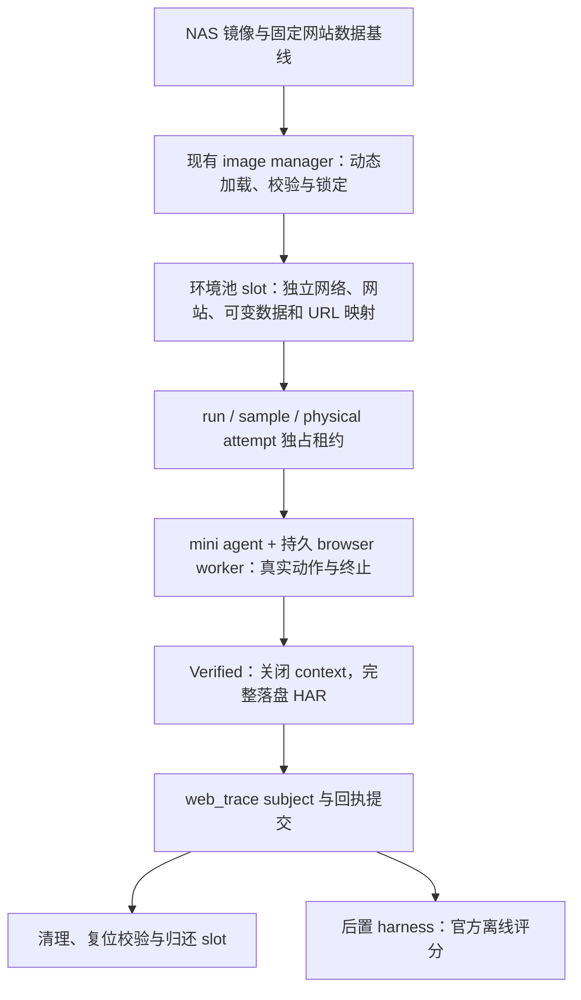

# DyConGlobal 接入 WebArena Verified 评估

核对日期：2026-10-31（北京时间）。远程工程：`wangtianyi@10.249.187.9:/home/wangtianyi/DyConGlobal`。

**范围已确定：仅接入 WebArena Verified。** 复用 mini-swe-agent、统一 run 调度、模型请求与 NAS 镜像动态加载，以结构化最终回答和真实浏览器 HAR 作为评测 subject，沿用 `rollout → harness prepare/run → RunEvidence` 的后置离线评测流程。原版 WebArena 仅作为差异背景与可选浏览器基础组件的来源；本次方案不新增原版任务导入、原版评分后端或清理前 live evaluator。

本次交付是源码与官方资料核对后的设计评估，未实施适配、安装依赖、加载镜像或启动 benchmark。评估阶段未修改运行实现；本次修订文档与 Git 整理另行提交，正在运行的任务不受影响。按用户要求，**沿用 NAS 保存 Docker 镜像、运行时动态加载的方案，不将 Docker 数据盘容量纳入接入约束**。

## 1. 核对范围与证据

| 对象 | 本次依据 |
|---|---|
| DyConGlobal | 当前工作树；Git HEAD `c59abd2effef9437addf4f1c035e38f1cb319036`，存在大量未提交修改，因此不能只凭 HEAD 复现本次结论 |
| 已安装 agent / harness | `mini-swe-agent==2.4.5`、`swebench==4.1.0`、Docker Python SDK `7.2.0` |
| 原版 WebArena | 官方仓库 `web-arena-x/webarena`，固定 commit `dce04686a56253aefba7b18a4fa0937cf1dc987b` |
| WebArena Verified | `ServiceNow/webarena-verified`，固定 commit `6473f72db5dcefc97b5725b59e734504edc28a21` |
| 当前新 run 默认值 | 根配置为 SkillsBench / OpenHands；全局 Catalog 检查结果为 87 个 SkillsBench task；不能据历史 SWE run 推断当前新建 SWE/WebArena run 已就绪 |
| 浏览器依赖 | runner 中 `playwright`、`browser_env`、`gymnasium` 均未安装；本次指定范围内未发现 WebArena 工程或对应本地镜像 |

已读取项目 `AGENTS.md`、README、ENTRYPOINTS、MINIMUM-RUN 和容器修复文档，再对照实际源码。本次本地取证保存了工程快照、SHA256 清单与固定版本官方资料；项目内源码引用见第 11 节。取证脚本与临时文件保留在本地任务目录，不作为项目生产入口提交；未保存 SSH 密码。

## 2. 选定 Verified 后的任务与评测契约

### 2.1 原版与 Verified 的区别（背景对照）

| 维度 | 原版 WebArena | WebArena Verified | 对 DyConGlobal 的影响 |
|---|---|---|---|
| 任务规模 | 812 题 | 完整集仍为 812 题；另有 258 题 Hard 子集 | Verified 不是简单过滤成更小的“已验证题集”；Full/Hard 必须冻结明确 selection |
| 任务关系 | 原版任务、参考答案与判定规则 | 审校并修改任务、答案、输出格式和 evaluator | 相同 task_id 不能视为同一实验任务 |
| 本次快照逐题比较 | 812 个唯一 ID | ID 集合与原版相同，但 **678 题 intent 文本不同** | 不能把两版同 ID 的成功率直接按等价题目配对 |
| 观测与动作 | 支持 accessibility tree / HTML / image，以及 ID 动作等接口 | 评测库对 agent 浏览器框架相对独立，主要消费回答和网络证据 | 可共用文本 accessibility tree + ID 动作；Verified 不要求更换为视觉 agent |
| 任务字段 | `start_url` 字符串，`eval` 字典，含 `storage_state` 等运行字段 | `start_urls` 数组，`eval` 为类型化列表，有逐题 `revision`；运行登录配置分离 | 只实现 Verified task 解析器，保留其逐题 revision 和运行配置分离 |
| 最终回答 | `stop [answer]` 的文本回答 | 结构化 JSON，含 `task_type`、`status`、`retrieved_data`、`error_details` | mini agent 固定输出 Verified JSON payload |
| 回答评分 | exact / must_include / fuzzy 等；部分依赖 LLM judge | 类型感知的归一化和结构比较，移除 LLM judge | Verified 评分可与 rollout 模型完全解耦，复评更易复现 |
| 导航/修改评分 | URL、页面 DOM、辅助函数和网站状态检查 | `NetworkEventEvaluator` 检查 HAR 中 URL、方法、请求/响应内容、headers 等证据 | Verified 必须在真实执行时捕获网络证据，不能只保存最终页面 |
| 无法完成的任务 | 一些任务使用 N/A 及相关判断 | 显式错误状态，例如 `NOT_FOUND_ERROR`、`PERMISSION_DENIED_ERROR` | agent 自行判断并输出状态；不能由适配器读取标准答案后替填 |
| 评测时机 | 完整评分通常需要仍存活的 browser/page 和网站状态 | 真实 rollout 后，可仅凭保存的回答与 HAR 离线复评 | 本次直接采用 Verified 后置离线 harness |
| 网站部署 | 原始网站镜像、登录 cookie，Map 配套服务 | 提供优化镜像、部分站点 header login、env-ctrl；Map 仍标 beta | 镜像和站点配置应按版本冻结，不能认为两版网站镜像可无条件混用 |
| 结果可比性 | 只与相同原版定义和运行协议比较 | 只与相同 Verified 定义、环境和运行协议比较 | 只报告固定 Verified 定义下的结果；不借用原版 resolved 标签 |

本地取证文件 `dataset_comparison.json` 保存了上述固定版本的逐题统计。678 是本次两个固定快照的**文本差异数**，不等于 678 个任务目标全部改变，也不代表历史所有 release 的固定差异数。

Verified 的 258 题 Hard 不是随机缩小的 Full 集：官方按难度和类别选题，包含全部 48 个多站点任务；不含单站点 Map 题，但多站点中仍有 19 题涉及 Map。因此选择 Hard **不能省掉 Map 适配**。Full 中有 48 个多站点任务，环境租约需一次绑定完整站点组合。

### 2.2 两个容易误用的细节

**以固定版本源码 schema 为准。** Verified 文档中仍存在 `action/results` 形式的旧示例，但本次源码 `types/agent_response.py` 的公开字段是：

```json
{
  "task_type": "RETRIEVE",
  "status": "SUCCESS",
  "retrieved_data": ["...agent 实际检索到的结果..."],
  "error_details": null
}
```

`task_type` 支持 `RETRIEVE` / `NAVIGATE` / `MUTATE`。`status=SUCCESS` 是 agent 声明，不等于评测通过。不能把原版自由文本答案自动改装成一个“默认成功”的 Verified 回答。适配时应冻结该版本生成的公开 schema 和提示模板；不可把 `eval.expected` 暴露给 agent。

**原版浏览器 `step()` 的 reward 不是题目得分。** `browser_env/envs.py` 返回的 `float(success)` 表示这次动作是否执行成功，terminated/truncated 也不负责判定完成；题目得分来自官方 `evaluator_router()`。Verified 同样应以官方 `TaskEvalResult` 为准。

### 2.3 已确定的实现范围

- 唯一新增执行组合为 `benchmark.backend=webarena_verified` 与 `agent.backend=minisweagent`。
- 支持固定版本的 Verified Full（812 题）与官方 Hard（258 题）selection；两者共用同一任务定义与执行、评分链路。
- 唯一评分器为固定版本的 `WebArenaVerified.evaluate_task()`；不引入原版 LLM judge，也不实现原版 live 评分或完整网站终态复评。
- 浏览器首选文本 accessibility tree + ID 动作，沿用当前 mini agent 模型工具协议。浏览器组件的来源不改变任务与评分必须来自 Verified 的要求。
- 从单任务扩展到覆盖各站点、三类目标与多站点任务的小集合，通过真实环境和证据验收后再运行正式 Full/Hard。

## 3. 各环节兼容性总表

下表“可复用”指已有机制适用；均不表示 WebArena 已通过运行验收。

| 环节 | 现状与可复用部分 | 必须补齐的最小适配 | 判断 |
|---|---|---|---|
| CLI / run 生命周期 | `core.cli`、create/start/status/cancel/resume、schema-2 plan、锁和冻结快照 | 增加 benchmark 分派、WebArena import/preflight；不新建 launcher | 高度复用 |
| Catalog / task identity | 已有 benchmark + revision + instance_id 的 task_key | 验证网页任务，取消 repo/base_commit 假定；修正当前二分式过滤 | 必改 |
| mini-swe-agent | DefaultAgent/DurableAgent、预算、保存、FormatError、loop 检测 | 浏览器 Environment 和网页任务提示；stop 提交 payload | 高度复用 |
| 模型请求 / serving | `rollout.model.make_model`、managed serving、seed、TP1 多卡 | 继续走同一请求链；冻结所用工具协议与观测格式 | 原则可复用 |
| NAS 镜像 | 镜像锁、NAS manifest/blob、identity、lease 和动态加载 | 一个浏览器镜像 + 多个站点镜像；保留服务 entrypoint；按 sample 租用站点集 | 扩展现有机制 |
| 网站状态 | 现有 SWE 是单容器/testbed；网页服务可能共享数据库和 volume | 独立环境池、复位/重建、登录验证、站点组合租约和回执 | 核心新增 |
| repetition / retry | 平坦 task×repetition 队列、physical attempt、seed 与限额重试 | 每个新 attempt 获得干净网站状态；禁止盲重发非幂等动作 | 调度复用，环境必须隔离 |
| canonical 产物 | mini trajectory + patch；另已有 workspace subject | 新增网页 subject，绑定回答、动作日志、HAR、环境身份；不伪造 patch | 必改 |
| Verified harness | 已有 selection/receipt、并发 worker、summary/evidence | 分派官方 Verified 离线 API，读精确 subject | 高度复用外层流程 |
| 在线 hidden / token | 现有请求身份、capture、NAS receipt、token ledger | 验证网页每个 assistant step/候选与原生请求、close hidden 的绑定 | 机制复用，需实测 |
| 离线 replay / enrichment | 已有 canonical reader、prefix 和标签 | 保留真实工具 schema/请求与 observation 文本；标签绑定网页 subject | 有条件复用 |
| parallel / consensus / entropy | 候选只生成和评分，选中后才执行 action | 选中候选唯一执行；DOM ID/观测版本绑定；验证无候选网站副作用 | 有条件复用 |
| difficulty | 训练、发布、推理骨架可复用 | 修正身份和 patch-only 检查；网页标签与划分；校准 estimator | 必须做领域验收 |
| action 分类 | 现有体系主要面向 bash/coding | 首版拒绝网页 action-classify；后续新增网页 taxonomy 和解析 | 暂不宣称兼容 |
| steering | 注入与服务机制不依赖题目类型 | payload 仍须匹配模型/site；网页效果需独立实验 | 机制可用，效果未知 |
| report / compare / artifact verify | 现有证据与相同 identity 配对 | 支持网页 subject、成功率分母与终态；Verified revision/selection 不混配 | 小范围扩展 |

## 4. mini-swe-agent 如何最大化复用

### 4.1 推荐路径：保留 agent 与请求链，替换环境边界

实际工程并非直接运行 upstream 的 `mini-swe-agent run swebench`：`rollout/runner.py` 创建 `DurableAgent(make_model(...), RolloutEnvironment(...))`。这个组合应保留。2.4.5 的 DefaultAgent 通过 `env.execute(action)` 获得 observation，天然允许替换环境。

需要增加一个长期维护的 `WebArenaEnvironment`，实现 `execute/get_template_vars/serialize/close`。它代理一个**跨步骤存活**的 browser worker，worker 内使用固定版本的官方 `ScriptBrowserEnv` 和 `create_id_based_action()`。不能每执行一次 shell 命令就新开浏览器，否则 tabs、登录、DOM ID 和任务历史都会丢失。同步 Playwright 对象由单个 worker/进程持有，不跨 rollout 线程混用。

最小首版可以继续使用当前 `bash(command)` tool 作为传输协议，提示 agent 发出单一浏览器命令，例如：

```text
bash(command="browser click [123]")
bash(command="browser type [456] [search text] [1]")
```

Environment 识别 `browser` 前缀后将余下动作交给官方 parser，调用持久浏览器，返回原版 AX tree、URL、tabs、fail_error 等文本 observation。这里的 `bash` 是兼容既有模型协议的工具名；网页 profile 必须明确其浏览器命令语义，首版只开放受控浏览器动作，不开放任意终端、数据库或管理接口来替代网页操作。这个封装是 **DyCon 的 mini agent 浏览器适配协议**，报告中应如实披露。

此路径可以保留 `LitellmModel` 的 bash-only parser、`make_model` 的请求证据、现有 tools_schema、FormatError、parallel parser、exact-action consensus 和 native token 对齐。stop 时由环境适配器走原生 `Submitted` 控制流，保存实际 Verified JSON 回答，产物按网页 subject 登记。

另一条路径是增加 `browser_click/browser_type/stop` 原生工具。它更清晰，但需要同步修改 tool schema、parser、observation formatter、request 保存、parallel 与离线重建；不能只换 system prompt。**首版不推荐承担这组额外改动。** 如果采用，应抽出同一个工具协议 owner，避免工具定义在多处漂移。

### 4.2 保持行为一致的约束

1. 初始 `reset()` 的 observation 必须进入第一条模型请求；仅传 intent 而不提供初始页面不可用。保存实际请求，不能事后补造 prefix。
2. 每个模型 response 首版只允许一个 browser action；同一 response 多 action 应在执行前按冻结协议拒绝并纠正，不能部分执行后才发现不支持。否则 assistant steps 与 browser steps、步数上限将不一致。
3. `stop` 不执行 git diff、不运行 SWE 提交 shell；Submitted 表示 agent 终止，resolved 仍只由评分产生。保留最后一次 tool-call/observation/terminal 配对证据。
4. `agent.step_limit` 是模型调用上限，WebArena browser action 上限需单独明确；FormatError 和 stop 是否计入都要冻结。不能直接继承当前 SkillsBench 的 250-step 配置；例如选择 30 个 browser actions 时，应明确这是本次 Verified 实验预算，不把原版 runner 默认值当作 Verified 的强制要求。
5. 循环检测可保留现有 reasoning/action 检测，另记录网站动作失败/重复；冻结本次 Verified 的停止/循环策略并在报告中披露，不引入原版 runner 的另一套隐含停止逻辑。
6. LLM 请求始终由 `make_model` 发起；browser worker 仅负责浏览器操作与 HAR 落盘，评分由后置 harness 承担。不得在 worker 中重新引入一个网页 agent 的独立模型客户端。

### 4.3 Python 与浏览器依赖

原版要求中有 Playwright `1.32.1`、OpenAI `0.27.0`、Transformers `4.33.2` 等旧依赖；不能把整份 requirements 安装进现有 runner/analysis/easysteer。建议将旧版 browser_env 和所需运行库封装到 NAS 发布的固定浏览器镜像中，runner 的 mini agent 保持 Python 3.12 与 2.4.5。只引入实际使用的环境模块；依赖裁剪须做 import/真实浏览验证。

Verified 评测库声明 Python ≥3.11，核心依赖包括 Pydantic `2.12.0`；浏览器是其 examples 可选依赖，不是离线评分必需项。可单独使用固定版本的评测镜像/环境，避免扰动 runner。旧 browser_env 也可以负责 Verified 的文本动作与 HAR，但这只是候选组合，必须验证其观测、认证和 HAR 完整性；不能认为 Verified 的现代 examples 浏览器版本与旧环境可随意互换。

## 5. 容器与 NAS：沿用 SWE 管理方式，新增站点集租约

### 5.1 可直接复用与不能原样复用的部分

复用 `runtime/images` 的 NAS 镜像描述、SHA/镜像 identity 校验、运行期动态加载、image lock/lease，以及现有 project/run/task/attempt/execution 标签与清理回执。公共镜像层可共享；浏览器、各网站分别锁定 image ID/digest。Verified 优化镜像也应先固定发布到 NAS，生产运行不依赖浮动 `latest`。

`runtime/containers/factory.py` 当前仍有 SWE 特定行为：默认推导 SWE 镜像名、`repo` 驱动 bootstrap、`/opt/miniconda3` + `conda activate testbed`、shell command 与单容器假定。网站镜像需要保留自身数据库/web service 的 entrypoint。建议在现有容器模块内增加显式 runtime policy / 站点集 adapter，保留共享底层 owner；不要复制整份 ContainerFactory，也不要让网站通过假的 repo/base_commit 躲过校验。

镜像与网站状态是两类对象：镜像从 NAS 动态加载解决可复现的只读基础；数据库、volume、用户操作和浏览器状态还需要独立复位。仅重新创建 Chromium context 不能恢复已经发帖、下单或修改的服务器数据库；重新建容器但复用脏 volume 也不够。

### 5.2 推荐的最小隔离模型



首版使用**一个网站集 slot、一次只运行一条轨迹**，把 reset/login/真实修改验证清楚，再扩展多个独立 slot。task×repetition 调度仍走原平坦队列，不新增 benchmark launcher。有效并发受 `min(现有轨迹 worker 上限, 可用环境 slot)` 限制；GPU 上有空位时仍需等干净网站租约。

同一 slot 必须覆盖该 task 所需的完整站点组合。48 个多站点任务不能拆成互不绑定的单站点任务。共享只读 Wikipedia/Map 组件只能在验证无任务状态互扰后优化，不能把全部服务一开始当作只读共享。

每次租约记录 image/data baseline identity、站点与实际 URL、container/network/volume、reset generation、登录检查、health check、owner 和 cleanup receipt。正式 resume 只复用冻结配置与已结算结果；未完成的网页 attempt 从干净状态重新运行，不承诺从中间 click 精确恢复。

动作超时也需区分发生位置。模型请求失败可以按现有请求策略处理；click/POST 已送达但响应丢失时，动作是否生效未知，不得直接重发。记录 action-started/terminal 回执及未知状态，优先检查现有会话证据；无法确认时将本 attempt 的基础设施事实保留，重建干净环境后按现有规则启动新的 physical attempt，避免重复下单、发帖或修改。

### 5.3 网站、网络、登录与清理

- 如果复用 `ScriptBrowserEnv`，其 `reset()` 只重建浏览器，不重置网站。Verified 本次采用每个 physical attempt 从已验证网站基线开始的隔离协议，将 reset policy 与基线身份冻结；不引入原版整套题目顺序执行的运行模式。
- Verified 的 env-ctrl 有初始化/状态等接口，但 **init 不等于已经验证过的数据库完全回滚**。需逐站点验证“执行修改→reset/重建→查询基线”；必要时恢复基线数据和 volume。复用官方站点操作，不自行复制站点配置/认证逻辑。
- Verified 的 `ContainerManager` 默认固定名字 `webarena_verified_<site>`，start 会移除同名容器；默认 Map volume 名也固定。不能直接并行调用它来启动多个 run。站点集 adapter 应复用现有容器 owner，或用其 backend 接口做 namespace 映射，并完整处理内部健康检查、volume 与名称关联。
- 现有 `network_mode=none` 不适用于浏览器访问网站。每个 slot 提供明确私有网络/端口映射，统一生成 task、登录与 harness 的 URL；`localhost` 在浏览器容器里不是宿主机。网站 absolute URL、重定向与跨站链接必须跟随实际映射验证。
- 使用 Verified 环境对应的官方登录/header 设置；若浏览器桥接需要 cookie，则在本 attempt 初始化时生成并验证。登录文件归 attempt，session/cookie 不能跨并发任务覆盖。agent 仅获得任务允许的网站信息，标准答案、Docker socket、env-ctrl 和数据库管理能力不暴露为工具。
- 取消仍由 run owner 处理：终止 browser worker，停止本 execution 的网站集，释放 network/可变 volume 和租约，保留已落盘证据。现有 `cleanup_execution_containers` 主要清理带标签的容器，新增 network/volume/lease 需要同一个清理服务扩展；共享 NAS 镜像不随任务取消删除。

## 6. Harness：复用流程，分别保持官方评分

### 6.1 唯一主路径：Verified 后置离线评分

推荐保留外层：

```text
dycon run create/start/resume
  → mini agent + 持久浏览器，采集网络
  → terminal answer + context.close() 后的完整 network.har
  → immutable web subject + canonical trajectory
dycon harness prepare
  → 冻结 rollout_id / subject_sha256 / evaluator identity
dycon harness run
  → WebArenaVerified(...).evaluate_task(...)
  → 官方原始结果 + DyCon summary + RunEvidence
```

官方 API 的明确调用点是：

```python
wa.evaluate_task(
    task_id=task_id,
    agent_response=Path("agent_response.json"),
    network_trace=Path("network.har"),
)
```

`WebArenaVerifiedConfig` 必须显式指向冻结任务文件、全部站点 URL 映射和评测设置；不使用 live 默认数据，也不依赖官方“从前几个网络事件猜各站点 URL”的 fallback，多站点情况下该猜测可能错误。

HAR 从初始页面访问前开启，覆盖所有 task tabs/pages、导航、修改请求及必要响应内容，关闭 context 后再计算 hash。普通 Playwright screenshot/trace.zip 不是自动等价的 HAR；保留原始 HAR，只有官方解析和必要内容检查通过才视为完整。不得只保留 request URL 而漏掉 POST data、response content 或 headers。应冻结并验证所用 HAR recording mode/content 策略。

评分 worker 只读 subject，不再调用 LLM 或重放网站动作。可复用 `harness_workers`、evaluation lock、selection receipt、每 rollout 结果、增量评测和 selected_evaluation_id。重复离线评测创建新的 eval_id，旧报告保留。

### 6.2 离线复评、异常与生命周期边界

完整 `web_trace` subject 提交后即可清理/复位网站并归还环境 slot；后置 harness 可在网站已停止时继续评分，评分重试不占用网站租约。HAR 缺失或未 flush 时保留不完整状态，不能用重新运行 agent 的 HAR 覆盖旧 subject。

评分在独立的固定运行环境内执行，复用现有 evaluation lock、worker 并发、progress/summary 和 run-local evidence。只根据冻结 selection 调用官方 API，不使用上游 CLI 自动发现任务来重新决定本 run 的评分集合；相同 task 的不同 repetition/attempt 各自绑定 subject，不按 task_id 覆盖。

复评使用新 eval_id，复用相同回答与 HAR，无需恢复浏览器或网站数据库。若有意升级数据/evaluator，建立明确的新评测身份与 provenance，不覆盖旧报告；正式比较仍按选中的 evaluation 与冻结协议解释。

**本次不实现原版 live evaluator。** 因此没有清理前题目评分阶段、原版 LLM judge、原版状态快照恢复或双评分的额外导航请求。

### 6.3 评分状态映射

| 来源结果 | DyCon evaluation_status / resolved | 备注 |
|---|---|---|
| Verified 官方 `status=success, score=1` | `completed / true` | 绑定精确网页 subject、任务与 evaluator |
| 官方评分正常执行但不通过 | `completed / false` | agent 声明成功不改变结果 |
| Verified 官方 `status=error`、评分器异常、HAR 截断、登录/环境不可用 | `infra_error / null`，并保留具体原因 | 官方 error 可能附 score=0，不能因此当成题目失败 |
| agent 回答不满足官方格式，评分器正常给出 failure | `completed / false` | 保存原始回答，不补造正确格式/状态 |
| agent 生成终止或 limits/loop，尚未评分 | `not_run / null` 或现有未完成状态 | 是否纳入失败分母由冻结统计协议规定 |
| 未选 parallel 候选 | 无该分支网页评分标签 | winner 的 resolved 不能传播给未执行分支 |

## 7. Canonical subject、身份与证据需要怎样扩展

只新增 `evaluation_subject.kind=web_trace`，用于 Verified 的显式 subject 类型；沿用已有 `subject_path/subject_sha256` 思路，不把网页回答写成 `patch.diff`。一个 subject 至少绑定：

| 内容 | 作用 |
|---|---|
| benchmark / release / task_id / task revision / task hash | 固定 Verified release、逐题修订与任务内容 |
| run / sample / repetition / physical attempt / canonical trajectory SHA | 复用当前执行身份与最终选择 |
| 原始 stop payload、`agent_response.json`、终止原因 | 保存实际 agent 输出；不混同 Submitted 与 resolved |
| 官方 browser action/state 日志与模型 step 对应关系 | 浏览器动作与模型 step 的对应审计 |
| HAR、必要页面/trace 辅助证据及各文件 hash | Verified 离线评分；辅助证据不代替 HAR |
| image、网站数据基线、slot/reset/login、实际 URL mapping | 解释网站运行状态与复现条件 |
| tools / prompt / observation policy / browser版本的 hash | 绑定真实模型输入与动作协议 |
| 完整性/清理状态、是否支持 post-hoc evaluation | 拒绝用不完整状态伪装可重评 |

Verified 官方评分读取回答与网络证据，不要求 subject 把整个网站数据库复制进每条轨迹，也不增加完整网站终态备份能力。浏览器观测是给 agent 的页面信息，task 中 `eval`、reference answer、expected HAR patterns 只供受控评分模块读取。

现有 `application/execution/subject.py:artifact_kinds()` 只有 workspace 才走 subject，其他全部退回 patch；`RunEvidence`、rollout import/finalize、harness selection、difficulty 数据集也有对应假定。必须一起扩展。优先复用明确的 subject helper，避免在每个模块增加各不相同的网页特殊判断；旧 SWE/SkillsBench 的序列化与 hash 保持兼容。

持久化顺序复用现有 journal 思路：agent terminal → HAR flushed → subject bound → artifacts committed → cleanup confirmed → rollout settled；后置 harness 再独立执行 evaluation persisted。只有完整 subject 可进入正式评分，rollout settled 不等于 resolved。subject 已提交但进程在 cleanup 前退出时，恢复只补幂等登记与清理；评分进程中断时针对原 subject 恢复或使用新 eval_id 重试，不重放 agent 动作。不可恢复的浏览器执行才进入新的 physical attempt。

## 8. Capture、并行策略与分析链路

### 8.1 Capture / enrichment / offline replay

保留 mini agent 和 bash 工具协议后，现有 `make_model` 的 request metadata、native token/response ledger、think_close、NAS publication 具备复用条件。浏览器不发 LLM 请求，也不会增加另一条未经采集的 reasoning 路径。

必须验收 canonical assistant step → native request/response → 显式 close token → hidden receipt 的逐项覆盖；包括最终 stop、FormatError、limit/loop 以及全部 parallel 候选。close 未生成、hidden 缺失、HAR 缺失是三种独立问题。浏览器动作成功/官方评分成功也不能证明 capture 完整。

离线 hidden replay 复用已保存的真实模型 prefix，无需重新运行网站。不得重新抓网页重建历史 observation，也不得在原始观测没有进入请求时事后补入。若更换原生 browser tools，要同步 request.tools、reconstruct 默认 tools 和 capture 启动检查，不能继续默认 bash schema。

### 8.2 Parallel / consensus / entropy

现有 coordinator 在模型候选生成/打分后返回一个 message，DurableAgent 再执行选中动作。这个时序适用于网站：同一步各候选共享固定 observation，**只有 winner 访问网站执行动作**。不需要为每个纯模型候选克隆整个网站。

需验证观测到执行期间 AX element ID/active tab 未变化，动作 receipt 绑定 observation hash 与页面/step 版本。后台 DOM 漂移导致动作失败时记录真实失败并重新观测，不能静默把旧 ID 重新解释到新页面。

保持 bash command 后 exact-action 共识可直接比较工具名和精确 command。语义相同但不同字符串不会自动合并；如增加正规化，作为显式新策略冻结并保留原始动作，避免擅自改变现有熵定义。未选候选不得触发 click、预览、请求或数据库修改。当前项目 B>1 依赖 close capture 与匹配 predictor，不能为网页绕过这些既有要求。

### 8.3 Difficulty、action 与统计

- **Difficulty 数据身份**：`difficulty/datasets/identity.py` 目前 SkillsBench 使用 revision，其他分支按 repo 分组。网页需使用 benchmark + revision + task_id；按 `intent_template_id` 分组划分训练/验证/测试，避免相同模板的不同实例泄漏。Full/Hard 是 cohort，不是天然 train/test。
- **成功剩余量**：以选中的官方评分证据 `resolved=true` 为资格，并绑定 exact subject；标签表示“距该成功终点剩余 steps/tokens”，不是理论最优路径长度。unresolved、infra_error、未评测均保留 null。
- **Estimator**：SWE 训练权重可以作为注明来源的迁移基线，但网页 AX tree/动作分布改变，不能直接宣称排序有效。先做 held-out 误差和候选排序校准；按 model/site/tokenizer 的现有 provenance 要求发布。
- **Action 分类**：现有 bash/coding taxonomy 会把 `browser click ...` 误归类成终端命令。首版通过 capability 拒绝网页 action-classify；后续再实现导航、检索、输入、修改、tab、stop 等独立 taxonomy，并复用 canonical reader。
- **Run compare**：保留相同 benchmark/revision 的 task×repetition 配对和 canonical token 统计。当前共同 submitted 分母适合效率对照，但不等于官方 benchmark success rate；正式成绩另报冻结全集上的 `成功样本数 / 计划 task×repetition 数`，同时列未完成、未评测和 infra_error 数，不只挑 submitted 成功路径。
- **Retry 协议**：基础设施 retry 与 limits/loop 换 seed 已存在，网页仍复用其记录。limits 后多次采样直到提交会改变与“每题一次、固定30步”成绩的比较口径；正式基准报告应禁用该额外采样，或完整披露允许的尝试数、seed 和累计预算，不能只报最后一次成功。

## 9. 最小实现的代码落点

以下名称是建议，**当前没有这些 WebArena 功能**。

| 现有位置 | 建议修改 / 新增 | 原因与回归范围 |
|---|---|---|
| `core/config.py`、`core/backends.py` | 只新增 `webarena_verified` 与 `minisweagent` 的 capability；根配置增加必要网站/浏览器设置；profile 验证按 agent 分派 | 目前 backend 枚举及 execution_context 仅覆盖 SWE/SkillsBench，不能套 OpenHands profile validator |
| `catalog/store.py`、`application/execution/run_plan.py` | 网页任务 validator、冻结 snapshot；显式 backend-family/revision 选择 | 当前过滤是“skillsbench / 非skillsbench”，加入网页后会串任务；保留历史 SWE family 名的显式映射，不能简单把所有 task.benchmark 改成 swebench |
| `catalog/webarena.py`（新增） | 读取 Verified 固定任务文件与 Full/Hard selection，保留源 task_id/revision/hash、生成快照 | 不复刻 `benchmark-pull` 中 SWE public-result 筛选逻辑 |
| `core/cli.py` | 小规模增加 `webarena import`、`webarena preflight`；run/harness/artifact/report 仍用原命令 | 同一个 core.cli 入口；不新增独立启动系统 |
| `runtime/containers/`、`runtime/images/` | 网页 runtime policy、站点集 slot/lease、NAS 多镜像锁、reset/login/cleanup | 复用现有 owner/SDK/manifest，隔离 SWE conda bootstrap |
| `runtime/agents/webarena.py`、`runtime/containers/webarena_adapter.py`（新增或同职责文件） | mini agent 生命周期薄适配、持久 browser worker、官方动作/观测桥接 | 共用 `DurableAgent` 与 `make_model`，不复制请求/重试/调度主循环 |
| `rollout/runner.py` | 按 capability 分派环境/attempt；复用公共开始、capture、最终导入和恢复逻辑 | 当前除 SkillsBench 外都进入 SWE problem_statement + patch 路径 |
| `application/execution/subject.py`、`rollout/artifacts.py`、`evidence.py` | `web_trace` subject、exact hash 验证、终态与评分绑定 | 不能用 workspace 或 patch 的默认 fallback 承接网页 |
| `application/execution/harness.py`、`benchmark_evaluation/` | outer prepare/run 分派；只新增 Verified 离线 evaluator | 保留锁/selection/summary/evidence，不把官方 SWE monkey patch 扩散到网页 |
| `artifact.py`、selection、comparison、difficulty dataset/identity | 从共用 subject/capability helper 读取资格与 identity | 彻底补齐 patch-only 检查，保留旧快照兼容 |
| 项目文档/测试 | 更新 ENTRYPOINTS/MINIMUM-RUN/容器指南及契约测试 | 声明 Verified 后置评分能力与 HAR 完整性要求 |

建议只抽取眼前需要的少量共用接口：task validation/selection、environment acquisition、subject binding、evaluation dispatch。无需为首版建立一个大而全的插件框架；也不要把新的 `if benchmark != skillsbench: 当作SWE` 留到下游再修。

### 建议配置与统一入口形态

共用模型、generation、agent limit、timeouts 仍在根 `config.yaml`；网站与浏览器设置也纳入同一 strict config，并在 run create 冻结。数据快照、镜像发布与 profile 可以是带 hash 的不可变引用，不能演变成另一套可变运行 YAML。旧 run snapshot 不修改。

```yaml
# 仅为待实现的字段示意，当前 config-check 不支持。
benchmark:
  backend: webarena_verified
  snapshot_ref: catalog/snapshots/webarena-verified-PINNED/manifest.json
agent:
  backend: minisweagent
  profile_ref: runtime/agent-profiles/minisweagent-webarena-PINNED/manifest.json
webarena:
  environment_pool_ref: runtime/webarena-environments/PINNED/manifest.json
  browser_image_ref: runtime/webarena-images/PINNED/browser.json
  observation_type: accessibility_tree
  action_protocol: bash_browser_id_v1
  environment_slots: 1
  reset_policy: per_attempt
```

```bash
# 下列 WebArena import/preflight 为建议新能力，尚不能运行。
# task ID 建议编码 wav-000，保留 source_task_id=0 的映射。
.venvs/runner/bin/dycon webarena import --source FROZEN_VERIFIED_DATA
.venvs/runner/bin/dycon config-check
.venvs/runner/bin/dycon catalog-check
.venvs/runner/bin/dycon run create WAV_SMOKE --operation rollout --task-id wav-000
.venvs/runner/bin/dycon webarena preflight WAV_SMOKE
.venvs/runner/bin/dycon run start WAV_SMOKE --detach
.venvs/runner/bin/dycon run wait WAV_SMOKE
.venvs/runner/bin/dycon harness prepare WAV_SMOKE --rollout-id ACTUAL_ROLLOUT_ID
.venvs/runner/bin/dycon harness run WAV_SMOKE EVAL_001
.venvs/runner/bin/dycon harness status WAV_SMOKE
.venvs/runner/bin/dycon artifact verify WAV_SMOKE
```

preflight 应从 run 快照加载网站配置，复用实际运行的 image/reset/login/URL/cleanup 检查；不发模型请求。root 配置变化后创建新 run；resume 不读取新设置。共享网站集定义只描述环境，不重新定义任务选择、模型请求或 evidence 写入。

## 10. 分阶段验收与投入判断

| 阶段 | 验证内容 | 通过条件 |
|---|---|---|
| G0：契约与回归 | task schema/identity、旧 SWE 与 SkillsBench run loading、网页 subject/hash、backend 选择与工具协议 | 网页不进入 SWE 分支；旧 hash/行为不变；篡改 HAR/回答/selection 被拒绝 |
| G1：环境 | NAS 镜像动态加载、逐站点 URL/登录、真实浏览器和修改/reset、多站点租约、取消清理 | 健康检查之外完成真实操作；复位后回到已验证基线；无跨 slot 状态污染 |
| G2：baseline | mini agent 从初始 AX tree 完成 retrieve/navigate/mutate；真实 Verified JSON stop；官方离线评分 | 实际调用同一 make_model；网站停止后 Verified 离线复评一致；每份结果绑定精确 subject |
| G3：证据与恢复 | canonical、HAR close、capture native/hidden、进程中断、retry/resume | 完整 step 分母；重复 finalization 幂等；新 attempt 用干净网站；损坏证据保持 unknown/infra |
| G4：parallel | 2 个再更多候选、consensus/entropy、多GPU TP1、多slot并发 | 未选候选零网站执行；winner 与 request/capture/动作一一对应；独立 repetition 无串扰 |
| G5：研究链路 | resolved dataset、template-group split、估计器校准、正式成功率与效率报告 | subject 与 selected evaluation 绑定；无跨版/模板泄漏；训练资格/统计分母明确 |

测试应围绕这些契约和真实故障：特别覆盖 `step reward=1 但题目不通过`、agent 输出 SUCCESS 但 evaluator 失败、HAR 未 flush、同名容器并发、脏 volume、评分重试不重新启动网站/agent、非幂等 POST 超时及取消后的 lease 回收。不会因为单元测试通过就宣称网站、完整集或 GPU capture 通过。

工作量的主要来源是**网站状态生命周期与 subject/evidence 泛化**；mini agent 主循环和 serving 不需要重写。实施顺序确定为：Verified task/profile 与网页底座 → mini agent baseline + HAR subject → 后置官方 harness → capture/parallel/difficulty 与正式 Full/Hard 报告。各阶段仅服务 Verified，不预先实现第二套任务或评分路径。当前没有真实网页 smoke 数据，因此不承诺通过率、速度提升或精确工期。

## 11. 主要源码索引与官方链接

项目源码（评估基于上文记录的工作树快照；下列链接指向当前项目文件）：

- [后端能力与身份](../core/backends.py)：当前支持组合及 SkillsBench execution_context。
- [Catalog](../catalog/store.py)：Task 的 repo/base_commit 假定和二分过滤。
- [统一 run plan](../application/execution/run_plan.py)、[rollout runner](../rollout/runner.py)：冻结、调度、attempt/capture/finalize。
- [模型请求链](../rollout/model.py)、[DurableAgent](../rollout/agent.py)、已安装的 `minisweagent.agents.default.DefaultAgent`（2.4.5）、`minisweagent.models.utils.actions_toolcall` 的 bash-only parser（2.4.5）。
- [容器工厂](../runtime/containers/factory.py)、[SWE环境策略](../runtime/containers/policy.py)、[现有 rollout environment](../runtime/containers/rollout_adapter.py)。
- [subject](../application/execution/subject.py)、[rollout import](../rollout/artifacts.py)、[RunEvidence](../application/execution/evidence.py)。
- [harness 外层](../application/execution/harness.py)、[SWE官方适配](../benchmark_evaluation/harness.py)、[difficulty身份](../difficulty/datasets/identity.py)。

官方固定版本：

- [原版 README](https://github.com/web-arena-x/webarena/blob/dce04686a56253aefba7b18a4fa0937cf1dc987b/README.md)、[官方运行与评分时机](https://github.com/web-arena-x/webarena/blob/dce04686a56253aefba7b18a4fa0937cf1dc987b/run.py)、[浏览器 reset/step](https://github.com/web-arena-x/webarena/blob/dce04686a56253aefba7b18a4fa0937cf1dc987b/browser_env/envs.py)、[评分器](https://github.com/web-arena-x/webarena/blob/dce04686a56253aefba7b18a4fa0937cf1dc987b/evaluation_harness/evaluators.py)。
- [Verified README](https://github.com/ServiceNow/webarena-verified/blob/6473f72db5dcefc97b5725b59e734504edc28a21/README.md)、[公开API](https://github.com/ServiceNow/webarena-verified/blob/6473f72db5dcefc97b5725b59e734504edc28a21/src/webarena_verified/api/webarena_verified.py)、[实际回答schema](https://github.com/ServiceNow/webarena-verified/blob/6473f72db5dcefc97b5725b59e734504edc28a21/src/webarena_verified/types/agent_response.py)、[离线评分实现](https://github.com/ServiceNow/webarena-verified/blob/6473f72db5dcefc97b5725b59e734504edc28a21/src/webarena_verified/api/internal/evaluator.py)。
- [Verified Hard说明](https://github.com/ServiceNow/webarena-verified/blob/6473f72db5dcefc97b5725b59e734504edc28a21/docs/getting_started/hard_subset.md)、[env manager同名行为](https://github.com/ServiceNow/webarena-verified/blob/6473f72db5dcefc97b5725b59e734504edc28a21/src/webarena_verified/environments/container/manager.py)、[镜像与volume配置](https://github.com/ServiceNow/webarena-verified/blob/6473f72db5dcefc97b5725b59e734504edc28a21/src/webarena_verified/environments/container/config.py)。
