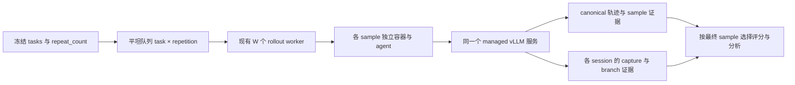

# DyConGlobal 同 task 多次 rollout 改造计划

日期：2026-10-24
检查对象：`/home/wangtianyi/DyConGlobal`（远程主机 `10.249.187.9`）
检查提交：`a009944cb7ff00b33f5d43e4145c67b44bf5eeb4`

状态：已实施（2026-10-24）。迁移、schema-2 work-items、重复调度和相关文档已写入远程工作树；远程当前仍有其他未提交修改，未执行提交或清理。本文保留设计决策和验收记录，不再把已实现接口描述为待实现。

本次按用户要求改为：对当前保存的 `runs/` 做一次显式迁移；迁移完成后，正式新版代码只处理新格式 active runs，不保留 schema-1 的运行时兼容分支。原始 run 不删除，移入只读 archive 并由迁移 receipt 绑定；这保留审计原件，但 archive 不再是新版运行入口。

实施结果：远程已生成 `migration/runs-to-repetition-20261024.json` 与 `migration/CUTOVER.json`；5 个正式 run 已迁移为 active schema-2、`repeat_count=1`，1 个无 plan 的历史目录已归档为 artifact-only。原始目录位于 `archive/runs-schema1/`，迁移校验通过。

## 1. 目标和边界

当前一个 run 内每个 task 只有一个最终执行结果槽位。若要为同一个 task 获取多条独立 rollout，需要创建多个 run；用户当前将这些 run 串行执行。仓库还保留了一个具有同类串行依赖的旧工具 `runtime/scripts/launch_selection.py`：它等待前一 run 的 supervisor 退出事件、清理和 receipt 完成后才启动下一 run。本文不假定用户正在使用这个旧工具，但它同样无法解决轮次之间的长尾阻塞。

目标是先把当前保存的 run 统一转成 schema-2、`repeat_count=1` 的新格式，再为新 run 声明大于 1 的重复数。迁移只改变运行目录/索引形态，不重新请求模型、不重跑 harness、不重做 capture；迁移后的 active run 继续引用原 trajectory、patch、capture 和 evaluation bytes，并完整保留其 provenance。重复采样与基础设施重试必须分开计数。

用户已确认：`repeat_count = 每个 task 计划执行的独立 rollout 总数`。例如 `repeat_count=5` 计划执行 5 次独立采样；容器损坏、网络错误等基础设施重试不增加独立样本数。每个 repetition 使用确定且不同的 seed，所有真实尝试和轨迹均保留。基础设施重试耗尽时，允许某个样本槽位最终失败，报告实际获得多少条有效轨迹；不能暗中追加新 seed 直到凑满 5 条成功结果，否则会改变实验分布。

## 2. 现状核对

### 2.1 已有的可复用结构

- `core.cli` 是统一入口；`run create` 创建 `plan.json`、`selection.json`、`tasks.json` 和 `resolved-config.json`，并通过 hash 冻结配置与任务选择。
- `application.execution.supervisor` 为一个 run 提供唯一 supervisor、执行 attempt、退出 receipt 和基于 pidfd 的事件等待。
- `rollout.runner.run_manifest` 已经在一个 run 内建立一个 `ServingManager`，再用 `ThreadPoolExecutor(max_workers=execution.rollout_workers)` 并行 task；所有 task 共享一个 vLLM 服务和 capture controller。
- `rollout.runner.run_task` 已有容器生命周期、模型请求、在线 capture、canonical trajectory/patch 导入、`RunEvidence` 登记和基础设施 retry。
- vLLM/vLLM 插件支持 `serving.max_num_seqs`、`max_num_batched_tokens`；capture metadata 包含 `run_id`、`task_id`、`rollout_id`、`session_id`、step 和 branch 身份；capture spool、flush、finalize、recover 已有持久化路径。
- `RunEvidence` 以 `rollout_id`、`task_key`、trajectory/patch SHA 和 evaluation 绑定证据；`difficulty`、`action`、parallel 分析均要求显式 source run 和 rollout selection。

### 2.2 当前限制和风险点

1. `run_task` 的工作目录是 `runs/<run>/rollout/tasks/<instance_id>`，并在该目录上加 `execution.lock`；`result.json` 存在且为终态时直接复用。因此同一 task 不能在同一 run 中安全地拥有多个独立结果。
2. `attempt_id` 当前表示一次执行尝试，既承担基础设施 retry 身份，又被写入 container label、trajectory metadata 和 capture session。直接把它当重复次数会把“新样本”和“失败重试”混在一起。
3. `import_rollout` 的 canonical `rollout_id` 是 `task_key + trajectory_sha256` 的内容身份。同字节轨迹复制到其他位置仍是同一份证据；重复调度不能通过复制或伪造 ID 充当独立实验。新真实执行应在保存原始轨迹时写入 repetition/attempt 身份，因此即使回答和 patch 相同，两次独立执行也有不同的原始轨迹证据。
4. capture metadata 要求显式 `run_id`、`task_id`、`rollout_id`，并在 finalize 时绑定 canonical trajectory SHA；重复样本必须拥有唯一的 session/repetition correlation ID，否则 close-only hidden 会串样本。
5. harness 对每个 selected `rollout_id` 提交一份 prediction，并以 `rid` 生成 evaluation task ID；重复样本可以并行评分，但报告和 evidence 必须保留每个 rid，不能按 instance_id 覆盖。
6. `runtime/scripts/launch_selection.py` 是旧的跨 run 串行队列工具，文档明确新 run 使用 `run start/wait/resume`。扩展它作为生产跨 run 调度器会与 run 快照、锁、capture 和 artifact ownership 产生两套入口；迁移后不再让它读取 active runs。
7. 当前根配置为 `execution.rollout_workers=12`、`serving.max_num_seqs=48`、`parallel.enabled=true`、`parallel.branch_count=4`、`parallel.max_inflight_branches=48`；即 12 个 rollout worker 在同时生成时最多发出约 48 个分支请求。重复数扩展工作量，第一版保持原有 worker 数和分支 admission，不把线程数乘以 repetition。这些值是当前配置，不能据此断言 GPU 已饱和或存在确定的加速比例。
8. 每个 `run_task` 的 worker 还同步承担 capture flush、prepare 和 finalize/upload；现有 `run_manifest` 的 futures 在这些步骤结束后才返回。跨轮次混排可立即降低 run 屏障成本，但 capture 发布仍可能占用 worker，需要测量后再考虑解耦。
9. `core.config.assert_frozen` 会拒绝修改后的配置对象。实现不同 seed 时不能在线程之间修改共享 `cfg['generation']['seed']`；必须传入独立 sample context，并记录实际请求 seed。
10. 当前 `run cancel` 只写请求记录，`run reconcile` 主要检查 plan/config/tasks 一致性；它们尚不保证协作取消或孤儿资源回收。迁移器必须先拒绝 live run、活动 supervisor、未完成 capture/upload 或不完整 receipt，不把在线恢复问题偷偷转成格式迁移。

### 2.3 本次远程 inventory（迁移前快照）

检查时 `/home/wangtianyi/DyConGlobal/runs/` 有 6 个一级目录：5 个含 `plan.json`/`resolved-config.json`/`evidence.json` 的正式 run（其中 4 个 rollout、1 个 harness），以及 1 个没有 `plan.json` 的 capture/startup artifact 目录 `capture-closeonly325-gpu47-w18-s16-bt2048-20261019-184246`。这个清单只用于设计依据；实施时必须重新扫描并生成带时间、git HEAD 和 inventory SHA 的迁移清单，不能依赖这里的数量。

没有 plan 的目录不能凭名称伪造 rollout run，也不能补造 task/repetition/seed。它要作为 `legacy_artifact` 迁移记录进入 archive manifest；若其 selection、resolved-config、receipts 和 canonical source 足够完整，另建不可执行的 schema-2 artifact record 供只读验证；否则标记 `excluded_with_reason`。这样“所有当前目录都有迁移结论”与“只有可证明身份的 run 才成为 active run”同时成立。

正式新版代码只扫描 `runs/` 下 `migration_state=active` 且 `schema_version=2` 的目录；archive、excluded record 和旧路径不参与 `run list`、`run start`、默认分析或生产选择。迁移报告必须列出每个旧目录的 outcome：`migrated_active`、`migrated_artifact_only`、`excluded_with_reason` 或 `blocked_live_state`。

实施后的实际 outcome 为：`migrated_active=5`、`migrated_artifact_only=1`、`blocked_live_state=0`、`excluded_with_reason=0`。CUTOVER 中登记的 active run ID 与迁移 manifest 一致。

### 2.3 关键源码依据

以下行号均来自本次检查的提交；本地 `source_snapshot/` 保存了用于核对的文件。

| 位置 | 已核对事实 | 对方案的约束 |
|---|---|---|
| `application/execution/run_plan.py:30`、`:118` | 创建/加载 plan，校验配置、tasks、selection hash | repetition manifest 也必须冻结并校验 |
| `rollout/runner.py:39` | task 级目录/锁/result；基础设施重试；capture 生命周期 | 调度粒度改为 task × repetition，复用执行主体 |
| `rollout/runner.py:242` | 单 ServingManager、线程池、task-key progress 和终态快捷恢复 | 保留 serving，替换任务展开和完成判定 |
| `rollout/runner.py:355` | 已有 spool 高/低水位 admission | 直接复用，不另建流控系统 |
| `rollout/model.py:11`、`rollout/parallel.py:85` | 普通请求使用根 seed；parallel 使用 seed + branch_id | sample seed 必须同时进入两条请求路径 |
| `rollout/artifacts.py:14` | 内容寻址 rollout、canonical 文件、RunEvidence 登记 | 保留 ID 算法和导入逻辑，增加真实采样 provenance |
| `application/execution/evidence.py:44` | 按 rollout_id 登记，多 rollout 可共享 task_key | 不必重建 Catalog 或全量重做 evidence |
| `runtime/serving/manager.py:199` | capture controller 的 export/spool 根绑定一个 run | 跨 run broker 不能只改 endpoint 或并发启动多个 run |
| `runtime/serving/capture.py:109` | CaptureRequest 显式解析并序列化字段 | 新身份字段要端到端透传，不能只塞进最外层字典 |
| `benchmark_evaluation/harness.py:160` | 每个 rid 单独 prediction、evaluation task ID 和 outcome | harness 已支持同 task 多轨迹；新增回归测试与汇总 |
| `runtime/containers/factory.py:227` | 每次创建随机容器名，label 含 run/task/attempt | 共享不可变 image、独立容器；attempt 身份要可区分 repetition |
| `application/execution/selection.py:7` | 后处理 selection 首次生成后冻结 | 多次采样完成前不能意外冻结一个不完整的默认分析清单 |

## 3. 方案比较与决策

| 方案 | 做法 | 兼容性 | 长尾改善 | 主要代价 | 结论 |
|---|---|---:|---:|---|---|
| A. run 内重复调度 | 在一个 run 的 immutable plan 中声明 repeat count；scheduler 把 `(task, repetition)` 作为最小 work item，共享一个 `ServingManager`/vLLM，独立保存每个 sample | 高 | 消除轮次屏障 | 扩展 run plan、runner、evidence 和 CLI | **采用** |
| B. 跨 run 调度层 | 建立 project 级队列，多个 run 的 task 交给共享 vLLM service；队列负责 run 顺序、资源和产物 | 中/低 | 高 | 跨 run 配置兼容、capture session 隔离、锁/恢复/退出语义和 provenance 全部重做 | 暂不采用 |
| A+B 混合 | 先在 run 内支持重复，另设 service pool 让多个兼容 run 复用服务 | 中 | 很高 | 两层 admission 和故障域复杂，容易把 run snapshot 与动态服务状态耦合 | 后续优化 |

选择 A 的原因是它直接复用现有不可变 run、单 supervisor、单 vLLM、capture controller、run-local artifact 和 `RunEvidence`。同一 run 中把每个 repetition 变成独立 work item 后，长尾只占一个 worker；队列可立即从其他 task 或 repetition 取新工作，避免“整个下一 run 被最长 task 卡住”。B 方案只有在需要多个不同配置的实验长期共享同一模型服务时才有价值，当前会引入比问题本身更大的跨 run 资源和 provenance 重构。

更精确地说，本次采用 A 的最小实现：**冻结 task × repetition 清单 + 现有线程池动态补位**。线程池本身已有工作队列和完成事件，不需要 Redis、常驻调度 daemon、跨进程租约或新的 task 数据库。新增持久化文件只保存必须的计划、attempt 事实和结果；progress 是可以重建的投影。

不要通过“把 tasks-file 中同一 task 写 N 次”实现，`create_run` 会拒绝重复 task ID，Catalog 的 task identity 也应保持唯一；不要把模型请求参数 `n=N` 当成 N 条 rollout，因为完整 rollout 含多轮工具执行和独立容器状态。

## 4. 目标运行模型

### 4.1 用户接口

扩展正式 CLI，而不创建 launcher 或绕过 `core.cli`：

```bash
.venvs/runner/bin/dycon run create repeat-20261024 \
  --operation rollout \
  --repeat-count 5 \
  --task-id org__repo-123 \
  --task-id org__repo-456
.venvs/runner/bin/dycon run start repeat-20261024 --detach
.venvs/runner/bin/dycon run wait repeat-20261024
.venvs/runner/bin/dycon run status repeat-20261024
.venvs/runner/bin/dycon artifact verify repeat-20261024
```

第一版只实现全 run 一个 `--repeat-count` 正整数，表示总采样次数，默认 1。所有性能/生成/预算参数继续来自唯一根 `config.yaml`；重复数作为此次实验的创建参数进入不可变计划，不再建立第二套可编辑配置。暂不支持 tasks-file 内每个 task 配不同次数、执行中追加样本或用配置和 CLI 同时定义重复数。`--repeat-count` 只允许 `--operation rollout`，正式 `rollout`、`start`、`resume` 均不能覆盖它。

`run create` 的 `tasks.json/selection.json` 仍列唯一 tasks；新增 `rollout/work-items.json` 才列出 task × repetition。`run show` 在启动前显示 unique tasks、repeat_count、planned samples、seed policy 和 worker 数量；`run status/report` 分别显示样本完成数、真实 attempt 数和 canonical rollout 数。

### 4.2 work item 和身份

对每个 frozen task 生成：

```text
sample_key = hash({version: 1, run_id, task_key, repetition_index})[:32]
repetition_id = rep-000, rep-001, ...
attempt_id = rep-000-attempt-000, rep-000-attempt-001, ...
```

- `repetition_id` 标识一次独立实验样本；它只在该 repetition 的基础设施失败时保持不变。
- `attempt_id` 标识该 repetition 的一次执行尝试；基础设施 retry 递增 attempt，不增加样本数。
- seed policy 固定为 `repetition_offset_v1`：`branch_stride = parallel.branch_count`（parallel 实际启用 B>1 时），否则为 1；`sample_seed = generation.seed + repetition_index * branch_stride`。branch 继续使用 `sample_seed + branch_id`。例如根 seed=42、B=4 时，rep-000 使用 42–45，rep-001 使用 46–49，rep-002 使用 50–53；普通 rollout 则为 42、43、44。创建时校验整个范围落在服务支持的整数范围，超界直接报错，不做隐式取模。
- 不同 task 可以使用相同的 repetition seed 序列；不同 prompt 和独立环境区分任务。seed 不依赖 run_id，方便以后在不同策略 run 间配对比较。相同 task 的各 repetition/branch 的 seed 块不重叠，retry 保持当前 repetition 的 seed。
- 第一条 repetition 和旧单次运行使用相同根 seed；保留现有每个 agent step 传 seed 的行为，不顺便修改为 step 级 seed。parallel baseline 的随机选择函数使用当前 sample_seed，保留现有 task/step/prefix 输入，无需更换其选择算法。
- `sample_context` 为只读执行参数，传入 `make_model/model_config/ParallelReasoningCoordinator`，覆盖请求 kwargs 中的 seed；不得修改共享冻结 cfg。实际请求 provenance 保存 base seed、sample seed、branch seed、policy/version、sample_key 和原 config_hash。
- canonical `rollout_id` 继续由真实 trajectory bytes 的 content identity 生成；`sample_key` 是调度身份。保存真实轨迹时一次性写入 run/task/repetition/attempt 和 sample seed，因此两个真实执行即使给出同样 patch 也可区分。导入已有字节仍去重，**不允许给一份旧轨迹追加新 repetition 字段来伪造新执行**。如发现同一 rid 被绑定到不相容的 sample identity，直接报冲突并保留原件，不静默合并或记作两个样本。

seed 不同是可复现实验设置，不承诺轨迹一定不同；同 seed 的 vLLM 输出也不能在不同并发批次、内核和硬件下承诺逐字节一致。

建议的 run 目录：

```text
runs/RUN_ID/
  plan.json                         # schema 2: repeat_count、seed policy、work-items hash
  selection.json / tasks.json       # 原有 frozen task selection
  rollout/work-items.json           # immutable: task_key、repetition_id、seed、sample_key
  rollout/tasks/INSTANCE_ID/
    repetitions/rep-000/
      execution.lock                # 只锁这个 sample
      attempts/rep-000-attempt-000/
        attempt.json                # 完整身份、执行状态、错误和时间
        raw.traj.json、container-spec.json、capture-errors.json ...
      result.json                    # repetition 的最终结果
  rollout/trajectories/ROLLOUT_ID/raw.traj.json
  rollout/patches/ROLLOUT_ID/patch.diff
  evidence.json                     # 沿用 schema 1，加可选 sample provenance
  progress.json                     # schema 2: sample results + counts，可重建
```

`raw.traj.json` 导入后继续按现有流程归入 canonical 目录并清理暂存副本；attempt 记录保留 canonical locator/SHA。attempt 目录、`attempt.json.attempt_id`、TaskContext 和 container label 使用同一个完整 attempt_id，避免 basename 与 metadata 不一致。

迁移后的 schema-2 run（包括 `repeat_count=1`）统一使用新布局；新版 `load_plan` 只接受 schema-2 active run，不能按目录是否存在猜测格式。新建 `rollout/sampling.py` 统一计划展开、路径/身份解析；不再提供 legacy adapter。schema-1 原目录只读存放在 archive，由迁移器和离线核验工具处理，生产 CLI 不读取。

`work-items.json` 示例（字段示意，hash 由实现生成）：

```json
{
  "schema_version": 1,
  "run_id": "repeat-20261024",
  "repeat_count": 3,
  "config_hash": "FROZEN_CONFIG_HASH",
  "selection_sha256": "FROZEN_SELECTION_HASH",
  "seed_policy": {"name": "repetition_offset_v1", "base_seed": 42, "branch_stride": 4},
  "items": [
    {"sample_key": "SAMPLE_HASH", "task_key": "TASK_HASH", "repetition_id": "rep-000",
     "repetition_index": 0, "sample_seed": 42}
  ]
}
```

每个 task 的所有 repetition 必须齐全且唯一。`load_plan` 从 frozen tasks、repeat_count、seed policy **重新展开预期 items**，校验逐项相等，再校验文件 hash；只重算 sidecar hash 不能掩盖任务删改。plan 自身 hash 仍沿用现有方式。

### 4.3 调度和资源 admission

在 `rollout.runner.run_manifest` 内使用 run-local 工作项调度，接收冻结的 manifest，保留 `ThreadPoolExecutor`：

1. 重建已完成 sample 的结果，校验其 task/sample 身份和 canonical bytes。若全部工作项已有结算结果，直接返回，**不启动 vLLM 或容器**。
2. 启动一个 `ServingManager` 和一个 capture controller；只执行一次 startup/tool-chain gate。gate 的 `startup-*` 诊断样本不计入重复数。
3. 将待执行项按 `(repetition_index, frozen task order)` 排序，形成一条平坦队列。**没有“本轮全部结束再开始下一轮”的屏障**。选择 repetition 为外层顺序使所有 task 先获得首个采样机会；当 task 数小于 worker 数时，同一 task 的多个 repetition 可立即并发。
4. 使用 `W=execution.rollout_workers`，最多保留 W 个未完成 futures；以 `concurrent.futures.wait(..., FIRST_COMPLETED)` 收取结果并补足队列。不要一次性创建 N×R 个 futures，也不需要让 worker 去偷取其他 worker 的队列。
5. worker 接收只读 sample context，按 sample 加锁，复用现有容器、model、retry、capture、canonical import 流程；不同 repetition 使用独立 agent history 和可写容器，镜像仍通过原 image lease 共享。
6. `admitted_task` 继续使用现有 spool 高/低水位检查；它可阻塞领取到的 sample，在途 capture 的后台 drain/upload 继续推进。不在 scheduler 中另写一套水位检查。Docker/image admission、pipeline deadline 和 parallel broker 均保留原路径。
7. 当前 sample 完成清理和必要 capture finalization 后，future 返回，由主线程原子更新 progress 并立刻补位。一个 task 的其他 repetition 和其他 task 不需要等待它的所有同伴结束。
8. supervisor 退出前保持现有 cleanup/finalize/receipt 流程；`run wait` 继续只等待 supervisor exit event，不轮询 progress。

伪代码：

```python
pending = iter(ordered_unsettled_samples)
running = {}
fill_up_to_worker_limit(running, pending)
while running:
    finished, _ = wait(running, return_when=FIRST_COMPLETED)
    for future in finished:
        sample = running.pop(future)
        persist_or_rebuild_result(sample, future)
    write_progress_atomically()
    fill_up_to_worker_limit(running, pending)
```

capacity 的层次必须分清：W 限制完整 rollout 数；B 是一次决策的候选分支数；`max_num_seqs` 是 vLLM 同时服务的序列容量；`max_inflight_branches` 是现有 broker 的组级 reservation 限制。`W×B` 可作为请求峰值估计，但工具阶段和排队会让真实并发变化。当前 12×4=48 与两项容量一致；超过时由现有 broker/vLLM 排队，不能用 `max_num_seqs - reserved_parallel_capacity` 推算 worker 数。第一版不增加第二个 `max_inflight_samples` 参数，不改 vLLM 内核调度，不改已有整组 branch reservation。



例如 W=3、A/B 两题、每题重复 3 次：初始可启动 A0、B0、A1；若 B0 先结束，B1 立即启动，即使 A0 尚未完成。即使任务清单只有一题，只要重复数足够也能使用多个 worker。整个批次最后只剩少数长任务时仍会有尾部空闲；本方案消除的是中间重复轮次屏障，不能消除所有最终长尾。

### 4.4 vLLM 对接

第一版保持一个 run 一个 managed vLLM 进程，不引入跨 run service broker：

- 在一个 vLLM endpoint 上并行承载不同 repetition；OpenAI request 的 `seed` 使用 work-item 的 `sample_seed`。
- 每个 request 的 `dycon_capture` 端到端透传 `sample_key`、`repetition_id`、`attempt_id`，普通模式也在 trajectory/request provenance 保存这些身份。`CaptureRequest.from_mapping/to_dict`、session/requests ledger、finalization 和 receipt 都要保留；不能仅添加 HTTP 外层字段后被解析器丢弃。
- `capture_session_id` 建议为 `cap-` 加 `hash(run_id, task_key, repetition_id, attempt_id)[:32]`，避免现有串接长 task ID 后路径过长；pending rollout ID 也含 sample/attempt hash。普通 task_id 保留真实 instance_id，不加后缀伪造成新 benchmark 任务。
- finalize 继续以真实 canonical trajectory SHA 和最终 `rollout_id` 完成绑定。capture、branch 和 NAS 根仍属于同一个 run；新增字段不改变 hidden 的数值定义、close-only/fp16、selected 标记或 label 规则。
- vLLM 的 `max_num_seqs` 只是服务并发上限，不等于可无限创建 rollout worker；parallel branch、capture queue 和容器资源必须保留 headroom。
- 若某 repetition 发生 model/API timeout，先按现有 infrastructure retry 规则结束其 session 并清理容器，再以相同 repetition、新 attempt 重试；不得复用旧 session 或把部分 capture 当成新样本。相同 seed 不表示恢复到同一个中间 token，resume 仍是 attempt 级重新执行。

普通、capture、steering、parallel、steering+capture 全部通过同一 work-item context 调用同一 runner；需要 startup gate 和现有测试分别覆盖组合，不新增另一条 rollout 执行实现。

跨 run 调度层只作为未来独立项目：除 service contract 兼容，还需要把 `ServingManager` 的服务所有权从 run 中拆出，让 controller 按 producer run 路由 export/spool/publication；具备 request namespace、per-run quota、service generation、故障隔离和 shutdown lease 后才可共享。仅让多个 run 配同一个 external endpoint 不能满足当前 online capture 对 managed serving 的校验，也不能解决 run 绑定的产物路由。

## 5. 代码改造分解

### Phase M：一次性 runs 迁移（先于任何新 scheduler 发布）

迁移必须是项目长期的**显式一次性工具**，放在现有 `migration/` 设计下并通过统一 CLI 调用；不是临时脚本，不启动模型/容器，不调用 rollout worker。建议接口：

```bash
.venvs/runner/bin/dycon runs-migrate-to-repetition \
  --source-root runs \
  --archive-root archive/runs-schema1 \
  --manifest migration/runs-to-repetition-20261024.json \
  --dry-run
.venvs/runner/bin/dycon runs-migrate-to-repetition \
  --source-root runs \
  --archive-root archive/runs-schema1 \
  --manifest migration/runs-to-repetition-20261024.json
.venvs/runner/bin/dycon migration-verify migration/runs-to-repetition-20261024.json
```

正式命令名可在实现时调整，但必须有 dry-run、apply、verify 三个明确阶段；不能通过 `run resume` 或某个隐含的 import side effect 迁移。命令开始时取得项目级 migration lock，并将 source inventory、当前 git identity、root config SHA、工具版本和命令参数冻结到 manifest。apply 前拒绝 live supervisor/process、未结束的 rollout/harness/enrichment/hidden operation、pending capture upload、未完成 artifact receipt、dirty staged target 或 archive 冲突；无法证明安全迁移的 run 进入 `blocked_live_state`，而不是边迁移边运行。

对每个正式 schema-1 run，先按 `operation` 分流；不能把 harness/analysis/hidden/enrichment 运行伪装成 rollout repetition：

- `operation=rollout`：按下列步骤生成 task × `rep-000`，成为可执行的 active schema-2 rollout run。
- `operation=harness`、`enrichment`、`hidden`、`analysis`：保留原 operation，只迁移 run envelope、plan/config/selection/evidence/receipt 的 schema 和路径引用；其 `sample_scope` 显式引用 source run 的 migrated active sample keys/rollout IDs，repeat_count 固定为 1 只表示“每个来源 sample 的一次后处理”，不创建新的 rollout work item，也不重新运行该阶段。若 source run 未在本批迁移前成为 active schema-2，则该后处理 run 先 `blocked_dependency`，不能生成半迁移 target。
- 没有完整 plan 的 artifact-only 目录：按 inventory 规则归档为不可执行记录，不进入上述 operation 分流。

对每个可迁移正式 run：

1. 读取并验证原 `plan.json`、`resolved-config.json`、`selection.json`、`tasks.json`、`progress.json`、`evidence.json`、`artifacts.json`、所有 trajectory/patch SHA、capture publication/receipt 和 harness selection；任何 hash/identity 不一致都在 preflight 阶段阻止该 run。
2. 对 rollout 生成新 schema-2 plan 和 `rollout/work-items.json`：每个原选中 task 生成唯一 `rep-000`、`repetition_index=0`、`repeat_count=1`。历史请求没有可证明的 seed 时写 `seed_provenance=legacy_unrecorded`，沿用原生成配置作为 source context；不得把根 seed 伪装成实际请求 seed。对后处理 operation 生成对应 schema-2 plan 和 `sample_scope`，严格绑定其 source run/selection/evidence SHA，不生成 rollout work item。
3. 将原 task-level result、attempt、trajectory、patch、capture、harness 和 analysis references 映射到 sample/attempt 结构；字节使用硬链接/复制都必须产生 SHA receipt，优先保留源文件只读并复制到 staged target，不直接编辑 archive 原件。canonical `rollout_id`、patch SHA 和 evaluation outcome 不重算、不改写。
4. 在 staged target 生成新 `plan.json`/`selection.json`/`tasks.json`/`resolved-config.json`/`work-items.json`/`evidence.json`/`artifacts.json`，写入 `migration/source.json` 与 `migration/verification.json`；所有 target hash 和 cross-reference 完整后才发布。
5. 在同一文件系统内将原目录原子 rename 到 archive，再将 staged target rename 为原 run ID。跨文件系统不能假装 atomic：使用 project-level lock、完整 copy + fsync + recursive SHA verify + rename marker；任何中断都保持 source 可读且 active 不出现半份目录。
6. 迁移后用新格式 verifier 重新检查所有 bytes、mapping、sample count、selection 和 publication；只读打开 archive 对照 source SHA。manifest 记录 `source_path`、`archive_path`、`active_path`、source/target tree SHA、outcome 和 error。

对没有 plan 的 capture/startup artifact 目录：只做 source inventory、receipt/hash 校验和 archive；若能生成完整只读 artifact record，则写 `migrated_artifact_only`，不放入可执行 `runs/`；信息不足则写 `excluded_with_reason`。禁止通过目录名或 `startup-verified.json` 伪造一个可 resume 的 rollout plan。

迁移引用策略：保留 run ID，使已有文档/selection/analysis 的 source-run 字符串继续指向 active 目录；所有引用到物理旧路径的文件改为 target 相对路径并在 mapping 中登记。NAS locator、capture session ID、trajectory/patch/evaluation ID 只在 SHA 验证后原样保留；不搬移外部大张量，只更新已验证的 locator receipt。若外部引用无法证明不变，run 标记 blocked，不生成 active target。

迁移发布完成后生成 `migration/CUTOVER.json`：source inventory SHA、manifest SHA、active run IDs、archive root、cutover time、tool/git identity。只有存在 CUTOVER 且 `migration-verify` 通过，生产新版 CLI 才允许启动；新版启动时发现没有 CUTOVER，应报“先完成一次迁移”，不能自动兼容/自动迁移。迁移 manifest/CUTOVER 进入只读审计范围，不随普通 run 删除。

**回滚**：迁移失败且尚未发布 target 时，删除 staged 临时目录；发布后若验证失败，停止生产 CLI，使用 CUTOVER/lock 将 active rename 到 `quarantine/`，再把 archive 原子恢复为 active，并记录 rollback receipt。禁止删除 archive 或把 schema-2 target 降级覆盖 source。回滚后新版必须停止，待修复后重新生成新的 migration batch，不能复用已失败 manifest。

### Phase 0：契约和兼容性

- `core/cli.py` 的 `runs-migrate-to-repetition`、`migration-verify` 和 cutover gate 先落地；迁移命令不得复用生产 `load_plan` 读取旧格式，而要有只读的 source verifier 与明确 schema-1 reader。
- `core/cli.py` 的 `run create` 增加 `--repeat-count`（默认 1），只允许 rollout；只有 CUTOVER 存在且当前 run ID 不在 archive/blocked/excluded 时才能创建 active schema-2 run。`create_run` 接收该参数并写 schema-2 plan；在创建目录前完成次数、seed 范围、任务选择和重复/冲突检查。
- `application.execution.run_plan.py` 的生产 `load_plan/show_run/list_runs` **只接受 schema-2 active run**，校验 `migration_state=active`、work-item 计数、唯一性和预期展开。不得保留 schema-1 fallback；archive 由 migration verifier 独立读取。
- `rollout/sampling.py` 新建只读 SampleContext 和唯一的 identity/path/seed helpers；不提供 legacy adapter。迁移器负责一次性把旧 task/attempt 映射到 sample；运行时没有双路径分支。
- `RunEvidence` 的生产 schema-2 row 必须包含 sample_key、repetition_id/index、seed provenance；迁移产生的历史 row 显式标记 `legacy_unrecorded`。schema-1 evidence 只由离线 migration verifier 读取，不进入 `RunEvidence` 生产类的 active 路径。
- 提前完成 migration dry-run/apply/verify、manifest 篡改、archive/active 原子切换、blocked live state、回滚、CUTOVER gate 和新格式 fixtures 测试；旧任务清单仍去重，不增加 Catalog partition、benchmark/task 定义副本。

完成条件：当前 inventory 的每个目录都有迁移 outcome；可证明的正式 run 均有 active schema-2 `repeat_count=1`；无法证明的目录只在 archive 有记录；CUTOVER 和 migration-verify 通过后，生产 CLI 对 schema-1/未迁移目录一律拒绝。新计划中 N 个唯一 task × R 次采样恰好展开 N×R 项；篡改 items 即使重算 sidecar hash 也被拒绝。

### Phase 1：run 内 scheduler

- `rollout/runner.py` 保留唯一 run_manifest/run_task/admitted_task，将参数扩展为 sample context，新增 bounded dispatch helper；不另建 supervisor、worker 命令或 production launcher。若 helper 长到需要拆文件，也只能移动调度代码，不能复制 runner 主体。
- 原 `run_task` 的 instance 级 early return 和 execution.lock 改为 sample 级；读取终态时同时验 identity、rid、patch/trajectory SHA，不能仅根据 exit_status 跳过。
- `runtime/containers/factory.py` 的 TaskContext 如需新增 sample 字段，使用可选默认值保证 harness/startup 旧调用兼容；事件/label 记录完整 attempt 身份。每次依然创建独立可写容器，用原 image lease 和 cleanup_owned。
- 当前 `offset=len(existing_attempts)` 的重试预算对每个 sample 单独计算。新布局严格解析序号并拒绝未知目录，按已分配的最大序号+1分配；预算维持总共最多 `1+infrastructure_retry_limit` 个 attempt，包括中断后重新执行，不因 resume 重置。
- worker 异常保留 sample_key 和具体 error，落盘 failed result；retry 耗尽也落盘 `infrastructure_exhausted`，避免每次 resume 再次报 WorkerFailure 或无限重试。Submitted、LimitsExceeded、reasoning_loop 等仍按原终态集合解释，不为未解决任务追加采样。
- `progress.json` schema 2 由主线程单写：包含 sample_key→result、planned/settled/terminal/failed/running/pending 计数，以及按 task 的 repetition 摘要。`application/execution/status.py/report.py` 只读 schema-2 active run；旧 progress 由迁移 verifier 校验并映射一次，生产报告不再支持两种结构。

完成条件：全量混排、最多 W 个 future、同 task 多 sample 可并发、完成样本 resume 零模型调用；retry 耗尽可稳定重现失败报告。

### Phase 2：capture、parallel 和产物

- 扩展 `hidden/backends/vllm/online.py`、`runtime/serving/capture.py` 的 metadata 解析/序列化、session manifest、finalization 和相关 receipt。旧 capture 无新增字段仍可读；schema-2 run 的新 session 必须校验 sample identity。
- `rollout/model.py`、`rollout/parallel.py` 从 sample context 获取实际 seed，并在普通/parallel 两条 native transport 路径保存；同一线程的 request UUID 不用作采样 seed。
- `rollout/artifacts.py` 复用 canonical 导入，对新 spec 保存 sample provenance；同 rid 与不相容 identity 冲突时拒绝，内容去重契约保持不变。
- `application/execution/artifact.py` 增加 work-items、sample result 和 attempt→canonical 关系校验；区分 requested_samples、terminal_samples、all_attempt_rollouts、final_rollouts。基础设施失败 attempt 的 canonical 轨迹可多于 N×R，这是保留证据，不是多采了样本。它只验证 active schema-2；迁移前的 source verifier 单独位于 `migration/`。
- `hidden/recover_online.py` 和 reclassification/repair 路径核对新 metadata 与 sample path；pending_upload 只重发布，不执行模型。

完成条件：同 task 同时运行的两个 repetition，无论 capture/parallel 是否开启都不会共享 session、attempt 输出或 seed 块；receipt、canonical SHA 和 sample 链路完整。

### Phase 3：评测和分析

- `application/execution/harness.py` 对已结算 schema-2 rollout run 默认按**每个 sample 的最终 result**选 canonical rid，不把该 sample 的前几个 infra-error attempt 当成独立重复样本。迁移后的 repeat=1 run 与新 repeat run 使用同一逻辑；archive 中的旧 harness 只能先经迁移 verifier，不由 production harness 直接读取。显式 `--rollout-id` 继续允许选择 active run 中保留的任意真实轨迹，并明确其 attempt 身份。样本无最终 canonical rid 则计为缺失，不生成伪 prediction。
- `benchmark_evaluation/harness.py` 已按 rid 生成 prediction、独立 evaluation_task_id 和 outcomes；保留实现，加“同 task 两条不同 patch 同时评分”的隔离回归测试，不重新实现官方 harness。一个 producer run 的 harness selection 只冻结一次；第一版在全部样本结算后 prepare，避免早期 selection 丢掉晚完成样本。
- `application/execution/selection.py` 提供所有后处理共用的 final sample selection helper；生产入口只接受 active schema-2 run，迁移后的历史 run 也必须先有 sample mapping。显式 rid 可分析 active run 中的 retry 轨迹但保存明确身份；新默认 selection 在未结算时给出明确错误，需要部分分析时使用已有显式选择能力，不能冻结隐式半份全集。
- `difficulty/datasets/*`、`enrichment/online_trace.py`、`action/datasets/trajectories.py` **保留已有 source_run/rollout/sample_id join 和内容去重算法**，增加 sample provenance；不全量更换 token/event 的 sample_id，避免让旧 hidden locator、receipt 和 dataset identity 失配。同样 patch 可来自不同 rollout，不能仅按 patch SHA 合并样本。
- parallel visualization/evaluation 本已要求 task 多 attempt 时消歧；新增 `--repetition-id` 仅作便利筛选，同时展示完整 attempt_id。`--rollout-id` 仍是最精确入口，歧义时继续拒绝选择最新。
- 报告保留每条 rid 的原始 outcome，同时增加 task × repetition 矩阵。分母明确区分 planned、obtained、graded、infra_error 和 not_run；未评测与基础设施失败的 resolved/remaining labels 保持 null。原有 resolve_rate 字段不悄悄换口径；新增 graded-only rate 和 planned-coverage。
- 第一版不默认输出 pass@k，也不按 solved task 提前停止剩余 repetition。若新增 pass@k，应另定义重复样本、失败过滤和估计器前提。difficulty 新训练实验优先按 task 分组切分，避免同 task 的不同 repetition 跨 train/test；现有 event_random_v1 不改名但必须明确其评估的是 event 泛化。

完成条件：两个 task×3 次重复得到 6 个最终 sample selection，retry 额外轨迹不混入默认样本；评分、hidden/action/difficulty join 与 task-level split 均不丢/串样本。

### Phase 4：观测、恢复和文档

- `run status/report` 第一版输出 unique_tasks、repeat_count、planned_samples、settled_samples、terminal_samples、failed_samples、pending_samples、attempt_count、final_rollout_ids；rollout 状态与 capture publication、harness grading 分开。
- 分别记录 queued/start/agent_done/canonical_imported/capture_finalized/finished 时间，汇总 queue wait、agent 时间、cleanup/capture finalize 时间、retry 次数。已有 parallel decision admission/decode/predict 指标直接复用。
- 新 scheduler 在每次 dispatch 前和 future 完成后读取已有 cancel-request，停止补位，正在运行的 sample 按原流程清理后结算；不承诺立即中断 native HTTP、工具或线程。若所有在途项长时间不返回，cancel 仍受已有 timeout 约束。`run wait` 仍只使用 pidfd；协作取消、强制 kill 是不同语义。迁移命令运行期间不允许任何 active run 执行或恢复。
- `run reconcile` 在 active schema-2 run 上只读检查 manifest、sample result、attempt/canonical 绑定，报告 orphan/interrupted 候选；自动杀容器、删除 spool 或修改证据不混入该只读入口。迁移器的 source/archive 检查走 `migration-verify`，不让 reconcile 猜测旧格式。资源恢复继续使用已有 recover/ownership 机制。
- 更新 `README.md`、`docs/MINIMUM-RUN-CN.md`、`docs/ENTRYPOINTS.md` 和工程 `GLOSSARY.md`：先执行一次迁移并检查 CUTOVER，之后正式入口只接受 active schema-2。旧 `launch_selection`、旧 supervisor 和 archive verifier 不作为生产重复 rollout 入口，保持明确的 offline/legacy 定位。

完成条件：用户能直接看清“计划采样数、已结算、有效终态、基础设施失败、待评分/待上传”，无需手动数目录。

## 6. 失败、恢复和数据一致性

以下是内部状态建议；它描述一次 sample 槽位的执行，不替代 agent exit_status 或 capture_status：

```text
pending -> running -> finalizing -> terminal
            |              |
            +-> retrying --+-> running (same sample, new attempt)
            +-> infrastructure_exhausted / failed
pending -> cancelled
running -> finish current attempt, then settle; do not dispatch new work
```

**结算不等于成功解决任务。** sample 可以以 Submitted、LimitsExceeded、reasoning_loop 等真实终态结算，也可以基础设施失败耗尽。run 在全部项结算后结束；若存在 failed/exhausted 则总体报告 failed，若因取消未执行全部项则 cancelled。不能因为 planned=settled 就一律写 complete，也不能因为 patch 提交就填写 resolved=true。

使用现有 `core.io.write_json` 的原子写、RunEvidence transaction 和 OS 文件锁。work-items 是唯一计划；attempt/result 是执行事实；progress/status 为派生投影。第一版不额外建立持久化队列数据库或第二套事件日志，最多 W 个活动 future，pending 从 manifest 减去已结算事实重建。

每个 attempt 需要先写 started 身份，再启动环境；保存轨迹后沿用 canonical import。调整当前 `path.unlink()` 的时机：至少在 canonical 登记和可恢复的 attempt/canonical receipt 落盘之后，最好在 sample result 原子发布之后，才删原始暂存副本。避免在“删除 raw 后、result 未写前”崩溃造成无法恢复关联。

| 中断/故障位置 | 恢复动作 | 是否重新请求模型 |
|---|---|---|
| pending 尚未领取 | 从冻结 manifest 补入队列 | 正常首次执行 |
| 容器/模型请求中断，无完整 canonical 轨迹 | 核对 supervisor 已退出和 owned 容器；保留 Interrupted attempt；有预算则新 attempt，同 sample_seed | 可以，attempt 级从头运行 |
| raw 完整、尚未 canonical import | 校验 attempt/sample 身份，复用原 import 补登记 | 否 |
| canonical 已登记、result 未写 | 通过 sample/attempt provenance 找回 row，校验 SHA，补 attempt/result；capture 按已存状态恢复 | 否 |
| agent 完成，capture/NAS 发布失败 | 保留 rollout 与 capture_status，走现有 capture recover | 否 |
| terminal result 已存在 | 校验 plan/sample/rid/hash；恢复为完成项 | 否 |
| 基础设施预算耗尽 | 保留耗尽结果，后续 resume 稳定返回该失败；新增实验需新建 run | 否 |
| 内容 hash/身份不一致 | 拒绝恢复，保留现场并报告证据冲突 | 否 |

HTTP 自身传输 retry、runner infrastructure attempt 和独立 repetition 是三层不同计数。基础设施失败 attempt 的真实轨迹若已登记，仍完整保留；默认实验 sample selection 只选择最终绑定。`CaptureError/block_rollout` 不应因重复数新增而变为自动重采样；record_and_continue 和 block_rollout 的原有策略分别保持，发布恢复也不能补出从未捕获的 hidden。

端到端只承诺结果登记幂等与可审计的重试，**不承诺崩溃期间 native 模型请求绝不重复**：若服务已执行而客户端未持久化回应，重试可能再次计算，但必须具有新 attempt/API request 身份，不能记为额外 repetition。

磁盘、image lease 和 capture spool 沿用已有预算/ACK 所有权。容器结束释放 image lease；spool 在 NAS ACK 前继续保留。不能在 sample 结束时一律释放或删除其未发布数据；run 退出后 pending_upload reservation 合理存在，并由 recover 按原规则处理。

迁移完成后的兼容边界改为：新版 active run 只有 schema-2；旧 schema-1 只能作为 archive 原件由显式迁移/审计命令读取，不能 `run list/start/resume/status`，也不能被默认 harness、enrichment、hidden、action 或 difficulty 选择。迁移不能为历史请求补造 seed、capture identity 或未发生的 repetition；历史 run 以一个 `repetition=1` sample 的方式登记时，必须保存 `seed_provenance="legacy_unrecorded"`、来源文件 SHA 和迁移工具版本，不能声称它拥有新采样 seed 证据。

原 run ID 尽量保持不变：迁移器先将原目录原子移动到 `archive/runs-schema1/<run_id>/`，再在 `runs/<run_id>/` staged 写入 schema-2 active 目录，并在 `migration/source.json` 保存 archive locator、原目录清单 SHA、迁移时间、source git identity、target schema 和每个 artifact mapping。若同名 target 已存在或原子替换无法完成，迁移该 run 记为 `blocked`，不得覆盖、部分替换或让新版看到半成品。archive 只读且禁止 symlink/fallback 回 active。

## 7. 验证计划

### 单元和契约测试

- `test_run_plan_repeat_count`: 默认 1、正整数校验、重复 plan hash、非法修改拒绝。
- `test_repetition_seed_is_stable`: 同一 task 不同 repetition 的 seed 块不重叠；resume、task 排序、worker 数和完成顺序不影响 seed；rep-000 与旧请求根 seed 一致；跨同配置 run 可配对。
- `test_scheduler_has_no_round_barrier`: 用 event/barrier 持有前一 repetition 的一个慢任务，断言下一 repetition 在释放该事件前已开始；同时断言未完成 futures≤W。避免用时间 sleep 制造脆弱测试。
- `test_retry_does_not_consume_repetition`: API/容器故障增加 attempt，不增加 repetition；terminal sample 不再次提交。
- `test_repetition_lock_isolated`: 同一 task 的不同 repetition 可并发；同一 repetition 不可双执行。
- `test_resume_reconstructs_queue`: 进程中断后只恢复 queued/infra_retry/interrupted item，保留 completed bytes。
- `test_equal_patch_is_two_executions`: 两次真实执行生成相同回答/patch，原始轨迹记录不同 sample/attempt identity，两个 rid 都保留；导入同一份已有字节仍只有原 rid，不能通过复制充当新 sample。
- `test_frozen_config_is_not_mutated`: 多线程请求记录正确 sample seed，cfg 和 config_hash 在执行前后完全一致；ordinary 与 parallel/parallel_baseline 的 native 请求都验证。
- `test_retry_budget_survives_resume`: 耗尽结果持久化，多次 resume 不加预算、不启动 vLLM；pipeline 全局 deadline 仍约束总实验，而非每个 repetition 重置。
- `test_final_selection_excludes_retry_attempts`: 每 sample 有多次保留的 infra 轨迹时，默认 harness/analysis 恰好选最终 rid；显式选择仍可检查旧 attempt。
- `test_migration_maps_schema1_to_repeat_one`: source SHA、trajectory/patch/evaluation IDs、task mapping、legacy_unrecorded seed provenance 和 target sample=1 完整；迁移不发模型请求。
- `test_migration_blocks_live_or_partial_run`: 活动 supervisor、pending upload、缺 receipt、archive/target 冲突会被阻止，source 不变且不会出现 active 半目录。
- `test_migration_archive_and_cutover`: 原 run ID 在 archive/active 映射一致，migration/source.json、tree SHA、CUTOVER 和 verify receipt 完整；重复执行同一 manifest 幂等，换 source 或 target 则拒绝。
- `test_production_rejects_schema1_without_cutover`: 新版 `run list/start/status/resume`、harness、analysis 遇 archive/schema-1/无 CUTOVER 均明确拒绝，不隐式兼容或迁移。
- `test_legacy_schema1_compatibility` 不再作为生产测试；只测试 migration source verifier 能读取旧格式并生成迁移报告。schema2 repeat_count=1 使用与新重复 run 相同的 runner。

### capture/vLLM/parallel 测试

- request metadata、session manifest、finalization、branch receipt 必须包含并校验 repetition/sample identity。
- 并行 repetition 的 branch seeds、decision IDs、selected branch 和 capture rows 不串 session。
- 沿用 `max_inflight_branches` 的整组 admission 测试，加上多 repetition 场景；验证 W 上限、spool 高/低水位等待和后台 drain，不另写模拟 vLLM 调度内核的测试。
- 启动/关闭时一条 session flush 慢或上传失败，不影响其他 repetition 的 canonical result；recover 后 receipt 状态正确。

### 端到端验收

先用 stub/fake agent 的事件阻塞证明无屏障；真实小规模验收用 2 个已有可用 task、每 task 3 次 repetition、固定 worker/模型/capture 配置，不为制造长尾修改 benchmark 题目或正式 agent。真实慢任务的速度只用于测量，不作为确定性的单元断言：

1. 看到 6 个 work items 在同一 managed vLLM 生命周期内交错执行。
2. 长尾 task 仍运行时，其他 task/repetition 已完成并产生 canonical artifacts。
3. `run status` 显示 planned_samples=6，每个 repetition 有独立 seed/result；无 infra 故障时有 6 个最终 rid。中断后 resume 不额外采样已完成项，失败耗尽明确显示 missing/failed 而不是凑数。
4. `harness prepare/run` 为每条 canonical rollout 生成独立 outcome；迁移后的 repeat=1 run 与新重复 run 使用同一 production harness，按 task 聚合报告与 raw outcomes 数量一致。
5. `artifact verify`、`run reconcile` 通过；所有容器和活动 session 正常结束。若存在 pending_upload，先验证其 retained spool/ACK 状态，再用 `capture recover` 发布并验证，不提前清理未 ACK 数据。

最近一次已记录的核心子集为 `79 passed`，parallel 专项为 `46 passed, 1 skipped`；完整 runner pytest 为 `567 passed, 29 skipped, 1 failed`。唯一失败是根配置引用的 predictor manifest `runtime/parallel-artifacts/ridge-event-reasoning-best-20261019/manifest.json` 缺失。本记录不代表之后其他工作树修改的测试结果，也不代表 GPU/capture 真实重复 rollout 验收通过。

性能指标以现有串行多 run 基线比较：总 wall time、GPU busy、vLLM request utilization、长尾期间有效在途样本数、capture flush wait、每 repetition P50/P95/P99；验收重点是消除 run 边界等待，而不是盲目提高并发导致 OOM 或 capture 丢失。

### 可量化的收益与限制

设 N 个 task、每 task R 次采样、W 个 worker、每次完整执行耗时 d(i,r)，managed serving 启动/诊断/退出开销为 H。串行多 run 约为 `R×H + Σ_r makespan({d(i,r)}, W)`；单 run 混排约为 `H + makespan(all N×R items, W)`。下界为 `max(Σd/W, max d)`，最终长尾、Docker/capture 等待和 vLLM 批次变化仍会影响耗时；这只是排队模型，不能当实际吞吐预测。

一个说明屏障成本的静态例子：W=3，A 每次120秒、B每次10秒，重复3次，忽略启动/capture开销。串行3轮需360秒；平坦队列 A0/B0/A1/B1/A2/B2 可在140秒结束，worker占用率由 `390/(3×360)=36.1%` 提升到 `390/(3×140)=92.9%`。该例是调度计算，没有在服务器上跑得这个加速比。若 task 很多且中间轮次尾部只占总时间很小，实际收益会更小。

真实对照先在同一模型/资源/任务和 seed 序列下记录每个 repetition 的时长、所有中间轮次的空闲 worker-seconds、服务启动成本，再比较连续调度。要比较新旧方案的随机样本，旧方案各 run 的根 seed 应与新 sample seed/branch seed 对齐；不要让 A/B 同时争用同一批 GPU。vLLM 动态批次可能改变数值路径，不能要求结果字节完全相同才认可性能测量。

如果数据显示 worker 的 capture finalize/upload 时间占比高，再做可选优化：拆成 bounded rollout 阶段与 publication 阶段，复用现有 CaptureSpool 上传 worker，先持久化完整 pending publication receipt，之后才归还 rollout worker。该优化涉及 recover、run 退出和 block_rollout 语义，必须另设验收门槛，**不作为第一版消除轮次屏障的前提**。同理，按历史时长把长任务提前排入只作后续实验，需冻结调度策略与来源，不能用当前 rollout 的未来结果排序。

## 8. 不纳入第一阶段的内容

- 不改写 archive 中已有 run 的 `resolved-config.json`、selection、trajectory、patch 或 evaluation evidence；迁移 target 可以复制这些字节并新增 sample/migration metadata，但必须保留 source SHA。
- 不复制一套模型请求、Docker worker 或产物登记逻辑；scheduler 只编排现有 `run_task`/`ServingManager`/`RunEvidence`。
- 不把多个 active run 的配置强行合并到一个共享 vLLM 进程；跨 run service broker 需要单独 ADR 和兼容性证明。
- 不把并行 branch 数当成 task repetition 数；branch 是一次 rollout 内的 reasoning 机制，repetition 是多个独立 rollout 样本。

## 9. 完成定义

实现目标已达到代码与迁移层：用户可用一次 `dycon run create --repeat-count R` 创建冻结计划；active runs 统一为 schema-2；迁移后的历史 run 为 `repeat_count=1`；未取得有效轨迹的槽位有明确结果；中间轮次使用平坦 work-item 队列。GPU/capture 真实大规模重复 rollout 仍需按资源条件执行专项验收后，才可声明端到端性能目标完成。

### 实施交付顺序与回退

1. **交付一：migration source verifier/dry-run。** 对当前 inventory 生成 manifest，审阅每个 outcome；尚不移动目录、不运行 GPU。
2. **交付二：migration apply/verify/cutover。** 先迁移一小批 fixture，再迁移当前保存的 runs；校验 archive、active、引用和 rollback。CUTOVER 前生产 CLI 继续停用。
3. **交付三：schema-2 普通 rollout 的混排/恢复。** 新建 repeat=1 和 repeat>1 run，用 stub 证明无轮次屏障；小规模无 capture/parallel 真实跑通，interrupt/resume 不重复已结算 sample。
4. **交付四：capture/parallel/steering 和下游。** 完成 session/branch seed/receipt、最终 sample selection、harness 与 action/difficulty 回归；重点覆盖当前正在使用的 fp16、think_close、B=4 模式。
5. **交付五：正式验收与文档。** root config 原资源参数下先 2×3，再代表性规模；保存性能/覆盖率/失败原因报告和 artifact receipts。通过后才用于大规模采样，不用改 archive 原件或迁移 run 的历史 bytes 来做验收。

每一步都在项目现有模块中交付长期功能及测试；临时诊断若确有必要仅放远程项目 `temp/`。不创建独立 launcher，不在本次设计阶段运行批量 GPU 工作。CUTOVER 后停止旧 schema-1 的生产读取；旧代码若不认识 schema-2 应明确拒绝。回退只能按 migration rollback receipt 恢复 archive/active 目录关系，不能通过改快照、删 work-items 或降 schema 来回退，也不能在未验证的 rollback 状态下启动生产 CLI。

### 主要风险及控制

| 风险 | 控制方法 |
|---|---|
| 把故障 retry 混进独立样本，或默认评测多了/少了 | sample/attempt 分层；每 sample 最终 rid；保留全部 attempts；默认 selection 集中实现 |
| 并发修改 frozen cfg 导致 seed/config_hash 不一致 | SampleContext 单独透传，cfg 只读；验证实际 native 请求 seed |
| 同 task capture 或容器产物相互覆盖 | sample 级路径/锁；完整 attempt label；session hash 与 ledger identity 校验 |
| 不完整 selection 提前冻结，后续样本丢失 | 新 run 的默认 harness/analysis 等待全部 sample 结算；显式选择保持独立 |
| crash 落在 canonical import/result 发布之间 | attempt 先登记；保留 raw 到 result commit；按 sample/attempt 补登记，禁止盲目重跑 |
| 重复数导致总时长超出 pipeline deadline/磁盘容量 | 保持全局预算语义，create/show 展示计划规模，原 admission/backpressure 生效，测试超限 |
| 以为更多重复会自动提升解题率或消除所有长尾 | 全部保留、报告真实失败/评分；性能目标仅去除中间屏障，最终尾部仍存在 |

术语草案见同目录 [GLOSSARY.md](GLOSSARY.md)；它是本计划附件，实施完成后再把相应新增术语合并到工程根词汇表。
