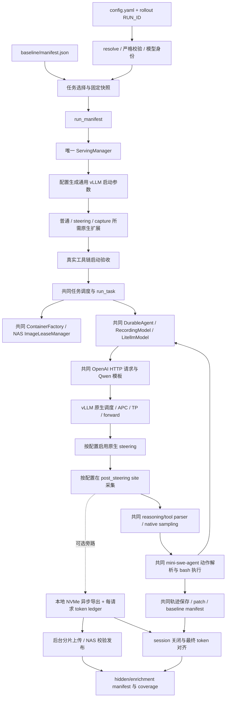

# 普通 rollout、capture rollout 与 steering 修理计划

本计划以当前 DyConGlobal 为对象。目标是修复配置入口漂移、采集错误处理和轨迹对齐漏洞，
并以真实工具调用验证正式执行路径。

实施状态（2026-10-18）：A–F 已实现并完成代码、故障注入、真实四模式、NAS 产物及 FP16 replay 验收。
正式 200-task 新运行已于 14:35:55 通过真实工具与采集发布启动检查。
具体测试结果、误差、产物位置及运行 ID 见[验收报告](rollout-capture-steering-repair-validation-20261018.md)。

用户本轮确定的边界：

- 后续生产任务统一使用唯一 `config.yaml` 控制的正式 rollout 入口。
- 速度测试不再运行；不修复、不依赖 `benchmark_rollout_throughput.py` 的启动和调度逻辑，
  不引用其结果作为普通/capture rollout 的验收依据。
- 不修复 `capture.dtype` 与实际采集存储精度的差异，不安排相关精度转换或精度矩阵。
  `serving.dtype=float16` 继续控制实际模型计算；实际 storage dtype 继续如实记录。
- 保留已有 rollout/容器/NAS 管理、mini-swe-agent、EasySteer/vLLM 原生批处理、APC、TP
  和图执行。新增代码只处理配置约束、必要的采集旁路、证据关联与状态管理。
- 当前 Qwen 在线采集仅支持 reasoning 换行、`</think>`，排除 `<think>`，使用原生 prefill。
- Capture 使用“本地 NVMe 有界缓冲 → 后台上传 → NAS 最终发布”。完整 prompt/output
  token IDs 按请求只保存一份，采集点只引用位置；不再把 NAS 当作逐点 staging 目录。
  本轮将这些存储优化纳入实施范围，具体见工作包 F；不因此恢复速度测试或调整存储精度。

## 1. 根因和修复范围

此次解析失败不是普通 runner 与 capture runner 使用了不同解析器实现，而是正式启动时
错误覆盖了 `serving.tool_parser=hermes`。当前两种模式共用 `ServingManager` 和模型客户端。
同一批已保存的 66 个响应，Hermes 提取有效 bash 为 0/66，原生 `qwen3_xml` 为 66/66。

除了恢复唯一配置的解析器，还须修复：

1. 正式入口接受行为覆盖、配置冻结后继续混入运行时字段，缺少模式差异约束。
2. `record_and_continue` 没有覆盖整个采集侧链路，采集回执/导出错误会中断 agent。
3. FormatError 响应绕过精确 token 证据记录，最终绑定又只扫描 assistant 消息。
4. `export.enabled`、`newline_policy`、`flush_interval_ms` 等选项未实际落实。
5. session stop、异步落盘、最终轨迹哈希及 coverage 的先后关系和失败状态不完整。
6. 错误启动/诊断轨迹仍可能进入正式数据选择，缺少运行前真实工具链验收。
7. NAS staging 反复压缩/读写、逐点重复 prefix 元数据，以及无有界本地缓冲的存储路径。

历史 agent 阈值为 10、当前唯一 config 为 3，不在本次修复中修改。其取值影响终止时机，
不是此次协议不匹配的根因。其他采样参数、提示词及 step/token 上限同样不借机变更。

## 2. 执行模式和共同调用链

Steering 和 capture 是两个独立开关，不实现三套 runner：

| 模式 | capture.enabled | steering.enabled | 执行入口 |
|---|---:|---:|---|
| 普通 rollout | false | false | 正式 CLI rollout |
| capture rollout | true | false | 同上 |
| steering rollout | false | true | 同上 |
| steering + capture | true | true | 同上 |



图中 forward、steering、capture、sampling 表示依赖关系，不替代或重写 vLLM 的具体内核流程。
一次模型 query 的操作顺序明确为：共同消息准备 → vLLM forward → 原生 hook（若开启）
→ 共同采样及服务端解析 → 共同 agent 动作解析 → 共同工具执行。
客户端只消费结构化 `tool_calls`，不新增 XML/JSON 正则补救解析器。

## 3. 必须统一与允许分支的边界

| 环节 | 必须统一的部分 | 必要分支 |
|---|---|---|
| 配置 | 同一 resolve、schema、冻结和 hash 计算；禁止模式私自改公共字段 | capture/steering 各自的功能参数 |
| 任务与调度 | 唯一 baseline manifest、同一选择接口、同一 workers/retry/timeout 逻辑 | 每任务可选 capture session |
| 容器 | 同一 ContainerFactory、环境修复、NAS digest 校验、4 loader、清理与租约 | 无模式分支 |
| 服务生命周期 | 同一 ServingManager，统一模型、dtype、parser、TP、KV、scheduler 参数构造 | 原生 hook/plugin/worker extension 的能力需求 |
| 模型请求 | 同一模型客户端、工具 schema、模板、采样、超时与原生重试 | steering payload；capture provenance/selector |
| 模型执行 | 复用原生 prefill、APC、GDN/KV 状态、continuous batching、TP | 原生向量 hook 和 capture hook；实际支持的图执行方式 |
| 响应与工具 | 同一 reasoning/tool parser，同一 mini-swe-agent 格式校验、工具调用和终止规则 | capture 只附加证据，不改动作判定 |
| 保存与登记 | 同一轨迹序列化、patch 保存、rollout_id、task/run/attempt 关联 | hidden/receipt/index/coverage/enrichment 产物 |
| Capture 存储 | capture 与 steering+capture 共用 ledger、缓冲、分片、上传与 artifact reader | 普通/仅 steering 不创建采集存储流程 |
| 故障 | 模型/API/容器故障使用共同分类 | 采集故障使用 capture.failure_policy，保留独立状态 |

不要求普通与 capture 的所有底层执行参数完全相同。capture 所需的 hook、图缓冲、
worker extension 和不支持的混合 batch 回退必须明确记录；这些差异不得扩散到 parser、
prompt、采样、agent 限制、容器环境或任务选择。普通 rollout 与非零 steering 的输出
不应被要求相同；steering+capture 必须与相同 steering 的参照条件比较。

## 4. 工作包 A：恢复正式入口和配置约束

涉及 `config.yaml`、`core/config.py`、`core/cli.py`、`baseline/catalog.py`、
`baseline/rollout/runner.py`、`runtime/serving/manager.py`。

### A1. 配置成为生产行为的唯一来源

1. 在唯一 config 中为当前 Qwen3.5-9B 明确设置：
   `serving.tool_parser=qwen3_xml`、`serving.reasoning_parser=qwen3`。
   模型身份、managed 服务、GPU/TP、workers、KV 等正式设置也写入该文件。
   本次继续采用 GPU4–7、workers=12、max_num_seqs=12；内存预算实施时根据实际空闲值
   核实后写入唯一 config，其余公共行为设置保持原值。
2. 正式调用只使用 `python -m core.cli --config config.yaml rollout RUN_ID`。
   开关 capture/steering 必须编辑同一 config。正式 rollout 子命令拒绝全局 `--set` 行为覆盖，
   给出“请修改唯一 config 或使用已有 run 的快照恢复”的明确错误；其他离线命令不因此重构。
3. `--resume` 仍读取该 run 的冻结快照，禁止用当前 config 篡改历史 run。
   修正错误 parser 后使用新 run_id，不改写错误启动的快照。
4. `capture_verified.py` 只保留一次性的静态数据/NAS 发布职责；其 prepare/snapshot/
   execute 启动职责迁入正式入口，撤销可再次使用的生产启动方式。正式入口不导入测速脚本。
5. 为当前 Qwen 在启动前验证解析器兼容性，允许原生 XML 解析器及其同类 alias；不静默
   猜测或替换 parser。明确配置 Hermes 应在批量任务启动前失败。

### A2. 任务选择仍以唯一 manifest 为准

扩展现有 Catalog/CLI 的选择参数，支持从 manifest 计算“尚无有效正式 rollout”的任务，
并可用重复 `--task-id` 限定本次 cohort。task-id 是已有 catalog 的选择条件，不是新配置文件。
将最终任务内容、task_keys、catalog revision/hash 冻结到现有 selection.json。
不新增 splits、不重写任务 partition 来筛选 200 个任务、不重新依赖旧工程目录。

### A3. 冻结配置与运行时对象分开

resolve → validate → freeze/hash → launch；之后不再改 cfg 中的行为字段。
动态 control URL、token inventory、PID、服务就绪状态放入小型 runtime context，
通过现有 ServingManager/run_task/make_model 参数传递，不混入已签名 cfg。
launch receipt 同时记录配置来源、原始 config 文件 SHA、resolved config hash、实际 args、
运行时版本和必要功能差异。启动前重新核验 hash，发现静默修改直接拒绝。

不建立第二套设置类、overlay 文件或另一套服务管理框架。

### A4. 合并参数拼装

ServingManager 内保留一个公共参数构造段，统一处理 max_num_seqs、batched tokens、dtype、
parser、KV、TP 等。capture/steering 只声明所需的原生扩展，由一个地方合并和去重。
特别是两者同时开启时，不重复追加 --enable-steer-vector/--steer-algorithms 等选项，
也不覆盖真实 steering 所需的算法。capture 开启但 steering 关闭时，仅激活 hook 基础设施，
请求中的 steering payload 仍是 False。

验收：四种模式的公共启动参数一致；差异只落在功能白名单。移除功能扩展字段后 HTTP
请求相同。完整 config_hash 随开关变化是正常的，不要求四种模式的整体 hash 相同。

## 5. 工作包 B：采集故障与 agent 行为解耦

涉及 `baseline/rollout/model.py`、`baseline/rollout/runner.py`、
`hidden/backends/vllm/online.py`、`runtime/serving/vllm_plugin.py`、`capture.py`。

### B1. 区分结果轴

保留 mini-swe-agent 的 exit_status，另记 capture_status（disabled、collecting、pending_upload、
complete、partial、failed、not_exported）和具体原因。提交成功但采集不完整可以同时成立；不把采集缺失
改写成 FormatError，不把 agent 正常终止直接等同于 capture 完整。

### B2. 明确 failure_policy

| 情况 | record_and_continue | block_rollout |
|---|---|---|
| 运行中绑定/回执/导出故障 | 记录采集失败，保留原模型响应和 agent 行为；有界停止失效采集旁路 | 以明确 CaptureError 中止，保存已有轨迹和采集证据 |
| native receipt 缺失或关联不唯一 | 标记 partial/failed，不伪造 exact 对齐，不纳入完整数据集 | 同上 |
| 队列背压、异步写失败 | 持久记录缺失事件/原因，coverage 不通过，agent 继续 | 同上 |
| NAS 暂时不可用，但本地已有完整副本 | 保留本地数据、记 pending_upload，后台重试；尚不判 missing/complete | NAS 超出配置截止时间后按 CaptureError 收尾，保留可恢复副本 |
| 本地缓冲达到容量边界 | 先暂停新任务准入；在途采集无法继续时标缺失/停止受影响采集旁路，agent 按既有逻辑继续；保留已落盘数据 | 有界中止并保留已有轨迹/缓冲 |
| parser、模型/API、容器错误 | 共同 rollout 既有处理，不能当采集错误吞掉 | 同左 |
| 配置非法或启动验收失败 | 批量启动前失败；不声称 capture 服务已正常启动 | 同左 |

策略必须覆盖客户端 session start、引擎 admission/bind、generate 完成后的 output receipt、
后台 drain、本地导出队列、NAS 上传/校验、stop 和 finalize。不能只在 controller.record 中处理一种错误。
尤其禁止在成功响应返回后，因 receipt HTTP 失败把整个 chat completion 变成 500，
也不为补采 hidden 重发或重新采样已经完成的模型请求。

### B3. 收拢超时和重复等待

复用已有 Condition/异步队列，不为每条请求建立轮询器。移除 query 成功后的强制逐轮
wait_output；先保存稳定 request 关联键，receipt 正常到达时关联，任务 finalize 时做一次
有界收尾。控制 RPC 和 finalize 的上限收拢到 capture 配置中，不继续散落 5/9/120 秒常量。
异步落盘不因为本次修复改成每个 token 或每轮 query 同步落盘。

验收使用故障注入：同一已给出的模型响应，在控制面断开、receipt 迟到/缺失、写盘失败
和队列满时，record_and_continue 的工具调用及 agent exit_status 与不采集参照一致；
block_rollout 则返回可辨认的采集错误。不得让这些异常落入普通模型基础设施重试并重跑任务。

## 6. 工作包 C：所有模型响应的精确 token 关联

### C1. 每次请求的标识

使用 Python 标准 UUID 建立 query_id；mini-swe-agent/LiteLLM 自身重试仍由原实现管理，
在既有 `_query` 调用边界给每次真实 API 尝试记录 attempt 关联键。
映射链为：task/run/trajectory attempt → query_id/API attempt → response_id →
native request_id → native prompt/output token IDs → capture absolute_position。
不得按 batch 顺序、仅凭 step 序号或“第一个匹配”猜测关联；多候选必须标错。

区分模型请求序号、agent step 和轨迹 message_index，保留既定标签含义。
格式错误回合属于真实轨迹消耗，其 reasoning 必须进入全轨迹 remaining_reasoning_tokens_after；
不把所有 query 简单改叫成功动作步骤，也不借修复重新定义已有 remaining_steps 口径。

### C2. 复用原生响应解析，覆盖 FormatError

不复制 LitellmModel.query 的重试、成本计算或动作解析。在已有 RecordingModel 包装处：

1. 调用原生 query，成功时附加共同 request 证据和关联键。
2. 捕获原生 FormatError，仅给其已有 error message 的 extra 附加相同证据，再原样抛出。
   保留原错误文本、响应内容、角色和 agent 连续错误计数。
3. 采用同一 response-record 读取函数，覆盖 assistant.extra.response 和
   user/FormatError.extra.response，供最终绑定、token trace 和 enrichment 共用。
4. 截断响应、普通格式错误和模型 API 重试均保留；没有返回的 API attempt 不算一个
   已完成模型响应，不凭空生成 token 序列。

### C3. 校验与封存

任务结束后以关联键和原生 receipt 做一次 join。每个实际 native request 的完整
prompt/output token IDs 只封存在一份不可变 request ledger，详见 F2。
轨迹、逐点 sidecar、enrichment 和 hidden 索引均引用该 ledger，不再各自嵌入完整 IDs。
在 baseline canonical import 前完成 ledger 引用及可用证据补写，再计算并冻结 trajectory SHA。
先保留 agent 的原始文本/动作，再附加证据，不能用重放输出替换在线原文。
缺失 receipt 时 record_and_continue 仍可导入 rollout，但其采集状态明确不完整。
finalize 不再只扫描 assistant，也不能在“无 assistant 但实际有失败响应”时空集合验收成功。

原始 hidden sidecar 保持不可变；通过 finalization.json 映射 pending rollout_id 到
canonical rollout_id 和 trajectory SHA。未完成请求、重试残留与 engine-warmup 单独标记
诊断，不进入正式事件/标签索引。回执 ID 校验同时核对 session、query/attempt、task、step、
token 序列及 checkpoint，防止跨 session 串联。

token_ref 使用稳定 request key、generation_index、absolute_position 和 token_id；
精确核验为 `absolute_position = len(prompt_token_ids) + generation_index`，并确认
拼接后的 token IDs 在该位置等于 token_id、存在对应的后续 input forward。
不因迁移本地文件到 NAS 改写 token 坐标、样本 ID、内容 SHA 或 canonical trajectory SHA。
新旧产物通过同一 reader 兼容：旧版内联 IDs/独立 NPZ 仍可读，新版解析 ledger 引用/分片成员，
不批量重写已有历史产物。既有 requests.json 汇总改为 ledger 引用和统计，不再复制完整序列。

验收必须包含“正常工具调用 → FormatError → 正常调用”“连续格式错误”“输出截断”
“receipt 乱序”“原生 API 重试”；逐请求验证 1:1 绑定和 token 数，拒绝重复/漏配。

## 7. 工作包 D：使其余采集配置真正生效

### D1. anchors 和 newline_policy

复用已有 tokenizer_newline_inventory/build_capture_select 作为唯一策略实现，
ServingManager、请求 metadata 和 finalizer 使用同一份已冻结 inventory/selector/hash。
只为实际选中的 anchors 建立 native selector；关闭 newline 时不再导出一批随后被 controller
拒绝的 newline 行。all 选择所有含换行的 tokenizer token；double_only 按已有 helper 的
定义，只选单 token 解码文本恰好为 `\n\n` 的条目；不默认为固定 ID 271。

tokenizer inventory 生成失败时阻止正式 capture 启动，不静默使用不完整的三 token fallback。
Qwen/GDN 继续拒绝 `<think>` 在线 FULL 采集和已知错误的单 token prefill；两个 decode
anchor 不写新的缓存复用调度逻辑，不修改原生 GDN 状态管理。

最终 reasoning 区间过滤和 coverage 必须复用同一 selector 及 anchors，不无条件要求
newline+close 两种事件都出现。结束 token 无下一次 input forward 时明确记
no_followup_forward，而非伪造 hidden。真实 batch_kind/graph_execution 继续由原生执行
观察证据记录，不能用 session 配置 FULL 代替每事件的实际模式。

### D2. export.enabled

enabled=true 使用工作包 F 的本地异步导出与 NAS 发布；enabled=false 不创建 tensor staging/NPZ/raw sample index，
不在 hidden/enrichment manifest 登记可消费的 hidden 数据集。必要 token 回执和状态保留
在 runs/<run_id>/ 的诊断记录中，capture_status=not_exported；不得把它算作 hidden 完整。
原生捕获缓冲仍须适时 fetch/clear 或通过原生关闭能力释放，不能因不导出而无限积压。
关闭导出的实现局限在 capture 旁路，agent 和服务公共参数不变。

### D3. flush_interval_ms

将其明确为捕获缓冲周期排空到异步导出通道的间隔，由 config 传入现有 plugin drain loop；
后台 writer 收到队列项后继续异步写，任务/服务停止时强制排空，不再等待周期。
该间隔不用于决定 NAS 单点同步写入；NAS uploader 按已封存分片/上传队列工作。
schema 要求正数，0 在配置检查阶段给明确错误，避免产生忙循环。
此内部采集排空循环不同于外部轮询任务进度；后者不再启动。

不调整 capture.dtype，保留实际 storage_dtypes 证据。

## 8. 工作包 E：收尾、产物与错误数据隔离

### E1. 生命周期

复用现有 session/controller/queue，顺序统一为：

```text
最后一次模型响应结束
 -> 原生 capture buffer 有界 drain（不停止其他任务 session）
 -> 本 session 不再产生新记录
 -> 本地异步 exporter 对本 session 的已入队项发出持久化完成/失败确认
 -> 一次 receipt join，封存 request ledger，补齐轨迹引用
 -> 保存并 import canonical trajectory，冻结 SHA
 -> finalization 绑定 rollout_id + SHA
 -> 基于本地已验证副本生成 token/event index、标签和 coverage
 -> 本 session 未满分片强制封存，交给后台 uploader
 -> NAS 上传并校验，发布可消费的最终索引
 -> 更新两个 product manifest 的 published/complete 状态，释放已获确认的本地副本
```

queue 使用每 session 已提交/已完成计数及 Condition 等待，不用全局 queue.join 阻塞于其他
11 个活跃任务。本地持久化完成后可释放该任务容器/worker，NAS 上传不占用 agent worker；
最终 run 收尾才对 exporter/uploader 做有界全局 drain/join，超时留下可恢复的 pending_upload，
不无限等待 NAS，也不把未上传数据宣告完整。任务级收尾通过 CaptureClient 封装，
不继续把 HTTP endpoint 拼装和吞异常散在 runner 中。

将当前 cohort 启动器里的完成后处理移到共同 runner 的可选 capture 收尾阶段，确保以后
直接运行正式 CLI 也能得到对齐产物。每轨迹收尾可增量完成，批量汇总在全部 future 返回后
运行一次；用现有 finalizer 增加按 session/rollout 选择，避免多套标签逻辑或反复扫描全 run。
正常/异常退出都保存收尾状态，不能在 finally 的二次异常中丢失原 agent 结果。

### E2. 产物位置

| 内容 | 位置 |
|---|---|
| 唯一可编辑行为配置 | config.yaml |
| 冻结配置、selection、launch args、状态 | runs/<run_id>/ |
| canonical 轨迹和 patch | baseline/trajectories/<rollout_id>/、baseline/patches/<rollout_id>/ |
| task/run/attempt、用途和评测状态 | baseline/manifest.json |
| 本地 NVMe 临时 staging、持久 spool、恢复日志 | hidden/spool/<run_id>/，由全局字节预算约束 |
| 每请求唯一的完整 token ledger | hidden/online/<run_id>/requests/<request_key>.json；上传前在本地 spool 有唯一待发布副本 |
| NAS 最终 hidden 分片与精简索引、session receipt/finalization | hidden/online/<run_id>/；默认 shards/ 下的标准 tar，保留其中 NPZ 编码 |
| 精确 token 对齐、标签、coverage | enrichment/outputs/<run_id>/<rollout_id>/，run 目录内汇总索引 |
| hidden/enrichment 产物登记 | 各自唯一 manifest；引用精简事件索引/ledger，不嵌入全部 token |

NAS 作为物理后端可继续通过 run 专属目录链接暴露在上述功能目录，receipt 同时记录逻辑/
物理路径。本地 spool 必须核验位于本地文件系统，不能因符号链接解析又落到 NAS。
复用已有 NAS 静态资产发布和 image manager，不新写 docker load/容器清理逻辑。
代码 .gitignore 增加 hidden/spool/** 等运行产物目录规则，不提交缓冲数据。

### E3. 隔离本次错误启动

实施开始时先按 process.json、进程命令和 Docker ownership labels 核对并结束本任务创建的
旧 supervisor/server/watcher，复用现有 factory/recovery 清理自有容器/租约；不影响其他 GPU
或其他 run。记录 interrupted/invalid_startup，保留所有已写出的轨迹、hidden 和日志。

仅对已确认的四个 run 做显式隔离：

```text
speed-baseline-20261018-034421
speed-baseline-20261018-035007
speed-capture-20261018-035007
capture-verified200-20261018-120720
```

在唯一 baseline manifest 的 provenance 中记录 quarantine 原因、证据路径和时间，清空
正式用途；Catalog 的默认数据选择和“未 rollout”计算统一忽略被隔离记录。
已有文件保持原路径供溯源；产物 manifest 对应 session 同样标无效，不伪装完整采集。
不用宽泛 speed* 前缀处理历史数据，尤其不改 speed20-20261011-registry_cap 等历史运行。
不更改 200 个任务的 partition；从 manifest 重新计算并核实仍为同一 200 个任务，冻结到新 run。

## 9. 工作包 F：本地有界缓冲、去重元数据与 NAS 异步发布

依据 `capture-storage-assessment-20261018.md`：现有 32-site hidden 每点压缩约 325 KiB；
当前两份 sidecar 各复制完整 prompt。平均 prefix 32k 时，每点连同元数据可接近 1 MiB。
现有 NAS staging → 解压 → 再压缩写 raw 的流程也增加了开销。本工作包直接修复这些路径，
不以存储精度转换、另开服务或改 vLLM 调度作为优化手段。

### F1. 唯一 config 中定义存储策略和总预算

在现有 `capture.export` 下补充字段，继续使用已有 paths.nas_root、export.root、enabled、
queue_size、flush_interval_ms。拟采用的初始配置为：

```yaml
capture:
  export:
    enabled: true
    root: hidden/online
    queue_size: 256
    flush_interval_ms: 100
    spool_root: hidden/spool
    spool_max_bytes: 53687091200     # 项目所有 run 合计 50 GiB，非每 worker/GPU
    spool_high_watermark: 0.8       # 40 GiB：暂停新 rollout 任务准入
    spool_low_watermark: 0.6        # 回落到 30 GiB 后恢复准入
    shard_max_bytes: 134217728      # 约 128 MiB；结束时允许最后一片不足此大小
    upload_workers: 2
    upload_max_elapsed_seconds: 600 # 一次发布重试窗口上限；超时保留本地待恢复数据
```

这些是本次实施需添加的正式配置，不创建另一份 spool/uploader 配置文件。
root/spool_root 作为逻辑根，run_id 由共同 runner 派生；运行目录不能覆盖其他 run。
水位必须满足 0 < low < high < 1；分片、临时归档和内存队列还须验证能放入总预算。
本地磁盘保留量复用现有 images.reserve_bytes，磁盘空间检查/预约和文件锁复用公共能力；
当 Docker root 与 spool 共用文件系统时，合并镜像加载预约和 spool 预约，避免重复承诺
同一份剩余空间。不新设第二套相互矛盾的磁盘保留参数，不修改既有 4 loader 上限。

spool 计费包括本地 handoff、raw NPZ、待上传 ledger/index、sealed shard、.part 文件及
在途预约；不是只统计成功写出的 raw 大小。封装 tar 暂时同时存在 raw 和 archive 时也计费。
预留少量收尾/错误日志空间，不允许把整个文件系统写满才发现预算不足。

### F2. 每请求一份 token ledger，逐点只保存引用

每个 native request 的最终权威 ledger 固定包含：

- request_key、session/query/API attempt/native request ID，以及 task/run/trajectory attempt；
- 唯一的完整 prompt_token_ids/output_token_ids、各自长度/哈希、结束原因；
- model/tokenizer fingerprint、请求所用模板/selector 的引用及必要校验值。

完成时封存为不可变的 `requests/<request_key>.json`。在输出尚未完成的阶段，prompt 的
临时状态可在内存或本地请求日志中保存；原子封存后不长期保留另一份完整 prefix 副本。
“只保存一次”指一份权威内容记录：上传期间的本地缓存/远端 .part 可短暂并存，必须同 hash、
计入预算，不能让多份文件各自演变为独立权威。

逐点索引仅保留 sample_id、request_key/ledger_ref、generation_index/absolute_position、
token_id、anchor、site/shape/dtype、实际 graph_execution/batch_kind、tensor locator/hash。
prompt/output token 列表、完整 selector/inventory、配置及消息历史不得继续复制到每个点。
raw sidecar 与 index 不再各自保存相同的大 JSON；本地恢复 journal 和最终精简事件索引使用
同一事件记录定义。每 run 的 tokenizer inventory/config 保存一次，由 hash 引用。

canonical 轨迹的响应证据引用 ledger 路径/hash；enrichment 的 requests.json 也只汇总引用。
共享 reader 负责按引用读取，调用者不各自拼接 token 序列。token IDs 能从 ledger 原样恢复，
不得依赖文本重分词来省空间。数据格式显式版本化，旧内联 IDs/NPZ reader 继续兼容。

验收：把相同请求的采集点数增加时，只增加小型事件索引和向量；32k prefix 不能再导致
每个点各增加两份数百 KiB 的 JSON。读取任意点仍能验证精确 token、轨迹位置及 SHA。

### F3. 只在本地完成 handoff 和一次张量压缩

```text
vLLM 原生 fetch / TP assemble
 -> 本地 NVMe handoff（沿用现有共享文件 + 元数据 HTTP，不经过 NAS）
 -> controller 接收 / 本地异步队列
 -> 一次 NPZ 压缩写入持久 spool + 精简恢复记录
 -> 封存标准分片
 -> 后台 NAS uploader
 -> 远端校验与发布确认
 -> 清理已确认的本地缓存
```

复用 CaptureClient.submit_staged、record_file 和 AsyncExportQueue 的边界，不另造 GPU
传输协议。若跨进程交接仍需临时文件，使用本地未压缩 NPZ 等现有 NumPy 能读取的载体，
不要先压缩、再解压、再压缩同一向量；最终持久 NPZ 才压缩一次，后续上传复制现成字节。
计算/存储 dtype 保持原样。handoff 成功和本地持久化完成分别确认，不能把内存入队当作
已经落盘。任何 NAS 路径、NFS fsync 或上传操作都不得进入模型 forward/采样或逐轮 query
的必要完成路径。

### F4. 用标准分片减少 NAS 小文件

复用现有 NPZ 编码、pack 的分组/核验逻辑和 Python tarfile；NAS 默认上传单元为约
128 MiB 的不可变标准 tar，内部保存已压缩 NPZ，不再对 tar 外层压缩。不按任务结束前
无限积攒：达到分片阈值即可封存；session 结束或退出收尾强制封存未满分片。
归档可以按 session 分组；预算/大小触发封片，不能等完整 200-task cohort 才上传。

最终 locator 记录 shard 相对路径、member 名、member SHA，以及 shard SHA。增加一个
薄的共享 artifact reader，以 tarfile.extractfile/NumPy 读取成员；训练、评估、token 对齐
和恢复均复用它，兼容旧的独立 NPZ 路径。不自定义归档格式，不改写 ndarray/层顺序。
原 raw 内容不可变，归档只改变封装。NAS 不同时默认保留完整 loose NPZ、同内容 tar 和
额外 packed tensor 三套副本；额外派生 packed 产物仍由显式消费需求决定。

数据集发布必须等待相关 shard、request ledger、精简 index 和 finalization 全部可用。
manifest 登记最终 locator，不能留指向已释放本地 spool 的引用。分片级上传减少 NAS
逐 token 创建、rename、fsync 的次数；仍保留逐事件随机定位所需的索引。

### F5. 上传、恢复与本地释放

上传状态至少区分 queued → local_persisted → sealed → uploading → nas_verified → published，
并记录 pending_upload/failed。复用现有 hash、原子文件操作、锁、journal 和 recover 入口，
只补上传状态和分片定位；这些运行状态不是第二份 task/split manifest。

1. 以稳定 shard/ledger key 和 SHA 幂等上传；写 NAS 的 .part，完成后校验内容与大小，
   在同一 NAS 文件系统原子 rename，最后发布索引/commit receipt。
2. 若目标已存在且 SHA 相同，复用；同名不同内容应报错，不能覆盖。并发写入由现有锁
   或 run 专属单写者约束。远端未完成 .part 不能被读者当作有效产物。
3. 只有远端完整内容与引用已验证、状态确认已持久化，才释放对应本地副本；失败和不确定
   状态保留本地恢复数据。恢复时重放 journal、核对文件与 SHA，不重新 rollout/重新采样。
4. 统一 recover 支持本地落盘后崩溃、封片后未上传、上传中断、rename 后未写 ACK、ACK 后
   未清理等断点。即使删除重复本地缓存，也不删除唯一剩余副本。
5. uploader 使用小规模独立后台进程/队列，隔离 NFS hard-mount 阻塞；超时不承诺能强行
   取消内核 I/O，而是标 stalled/pending、限制新准入并返回可恢复状态，禁止无限增生替代
   进程。收尾上限来自唯一 config；重试采用有界退避，不是外部轮询 rollout 进度。

本地完整但 NAS 尚未确认的数据保持 recoverable/pending_upload。可单独确认其本地
token coverage，但整体 capture_status 不得写 complete、对外 published 不得为 true。
已有 rollout 的 agent 状态与 NAS 发布状态分别记录，不为上传失败重复执行任务。

分片的 artifact_state 与整个 session 的 capture_status 分开：长任务尚未结束时，已上传且
校验完成的分片即可释放对应的大块本地缓存；保留小型定位/恢复记录，尚未封存的 ledger
继续留在本地。无需等整个 session/200-task 数据集 published 才回收每个分片，否则正常
上传也可能把本地缓冲耗尽。最终 index、ledger、轨迹绑定与所有必要分片齐备后，才把整个
session/数据集标为可消费；对齐/标签收尾复用已验证元数据，避免为此重复读取所有 tensor。

### F6. 水位、在途任务与故障策略

高水位暂停的是共同 runner 中新任务的准入，复用 executor/future 和现有 Condition，
不新写一套 rollout 调度器；上传 ACK 降至低水位后事件通知恢复。已执行任务继续使用其
已获预约，不因水位变化重新创建容器或模型请求。

高水位不是硬上限替代品。每个 handoff/持久写入/封片都先按实际字节预约；12 个在途任务
仍可能耗尽剩余空间，到达硬边界时按 B2 处理，不在 GPU forward 中无限阻塞。禁止覆盖
旧缓存来腾位置、静默丢弃未上传数据、或者只标 agent complete 而掩盖采集缺失。
普通 rollout/仅 steering 不受未开启 capture 的 spool 管理器影响。

## 10. 验收矩阵与顺序

### 阶段 1：CPU 与隔离协议测试

1. 配置：正式入口拒绝行为覆盖、冻结后篡改可被发现、resume 不读取新值。
2. 四模式启动参数对比：公共字段一致；仅允许表中定义的原生功能差异，参数不重复。
3. 四模式请求对比：公共内容一致；steering payload 与 capture metadata 分别独立。
4. 同一批保存响应使用配置指定的原生 qwen3_xml 解析，66/66 可提取有效 bash；不重写 parser。
5. 格式错误、截断、API 重试、乱序/缺失回执的 token 关联；同一 response-reader 用于最终对齐。
6. 所有采集侧故障的两种 policy；原始 agent 状态保留，失败不伪装 exact/complete。
7. anchor 子集、all/double_only、export on/off、flush 间隔、生效的停止排空和 writer 失败。
8. 隔离记录默认不被选择，旧 1,104 条历史轨迹与已有评测绑定不受影响。
9. 32k prefix 与多采集点的去重检查：完整 IDs 只存在于唯一请求 ledger，逐点 JSON 大小
   不随 prefix 长度线性增长；新版引用和旧版内联证据都由共享 reader 正确还原。
10. 本地→标准 tar→NAS 的成员字节/hash 完全一致；同一点的 tensor 编码只做一次压缩，
    无 NAS staging 重写。读取 loose NPZ/分片成员能得到完全相同数组，不调整存储精度。
11. 使用故障注入和已有小样本验证 NAS 暂停、校验失败、上传重试、.part、ACK 丢失及各个
    崩溃断点：未确认前本地文件不释放，恢复幂等，不启动新的模型请求，不提前发布 complete。
12. 多 run/12 worker 的并发字节预约，包含 handoff/.part/封片瞬时占用；验证 50 GiB 项目
    总上限、高低水位准入、在途任务到硬上限、与 Docker 空间预约的互斥，不做速度测试。

### 阶段 2：真实 GPU 工具链四模式验收

使用当前 Qwen3.5-9B、FP16、相同公共 config、已验证 NAS 容器，通过同一正式 CLI 启动。
采用有限小任务/检查提示，不运行速度测试，不做吞吐比值或每秒 token 指标。
不同模式分次修改同一个 config 并冻结到各自 run，不建立四份可编辑配置文件。

| 模式 | 必须实际通过 |
|---|---|
| 普通 | 服务确用 qwen3_xml；生成结构化 bash 调用；容器执行并返回真实 observation；轨迹可登记 |
| capture | 上述全部；reasoning newline+close 多层/全层有限值；native token 精确对应；实际 FULL decode 证据；本地落盘与 NAS 分片发布可核验；覆盖验收通过 |
| steering | 相同 parser/容器/agent 链路；非零向量确由原生 worker 接收并作用，不能只用零向量冒充开启验收 |
| steering+capture | 上述组合；post_steering site 和 payload 身份有证据；共用同一个 ledger/spool/uploader；不存在双重 hook/重复命令行设置 |

另加一个可控的真实混合 prefill/decode 请求场景，只验证正常输出、实际执行模式记录和
采集覆盖，不强求不支持的 batch 走 FULL，不改变原生调度以凑验收。

模式对比不把随机采样输出逐字相同当作普遍承诺；共同请求/参数一致、真实工具调用成功、
无 token 0/NaN 退化是基本门槛。非零 steering 应与相同 steering 配置比较。

存储验收以实际 published locator 从 NAS 读回两个 anchor 的 hidden，join 单份 request
ledger 和 canonical 轨迹引用；检查所有 shard member/ledger SHA、层数及坐标一致。
人为延迟 uploader 时，验证模型请求不依赖 NAS I/O 完成、本地数据可恢复，以及水位策略
按配置生效；这是正确性和故障隔离测试，不计算本地/NAS 吞吐比值。

### 阶段 3：精确关联和既有数值门槛

从修复后的少量真实 online 请求的已发布 ledger 取 exact native token IDs，使用统一 reader
从 NAS 分片读取 online hidden，再通过既有 vLLM replay 路径
做 FP16 重放，采用同 checkpoint、TP、site 和 steering 条件。沿用已有余弦/相对 L2
验收阈值（cosine >= 0.999、relative L2 <= 0.05），不得临时放宽；报告每层、每事件误差。
这是正确性回归，不是存储精度测试或速度测试。核对标签跨所有后续 reasoning 回合求和，
并覆盖 FormatError 响应；没有 exact 证据的行不进入合格训练索引。

### 阶段 4：恢复正式 200-task 运行

前述必要验收通过后，写入最终唯一 config，复核 GPU4–7 空闲显存和既定 12 workers/
max_num_seqs=12，重新固定同一 200-task scope，使用新 run_id 从正式 CLI 启动。
通过同一服务、同一请求构造器做一个与生产任务隔离的真实工具调用启动检查；涉及 capture
时同时验证两种 anchor、层覆盖、有限值及 exact token 关联，warmup/验收 session 不混入正式数据。
该启动检查还须完成一次短分片封存/上传、NAS hash 校验和 ledger 引用读回；只看到本地
spool 有 NPZ 不足以证明最终保存链路正常。
启动检查失败则不释放整个任务队列。真实首批任务完成有效工具调用后记录 startup receipt，
不以 HTTP 200、结束状态或“测试套件全绿”替代工具链启动成功。

启动后不再轮询任务进度。主 runner 本身等待任务 future 并做每任务/最终收尾；脱离 SSH
的 supervisor 等待其退出并记录结果，无定时状态检查脚本。恢复正式 run 不等待 200 条全跑完
才向用户报告已正常启动；但缺少实际工具/采集证据时也不能提前宣布成功。

## 11. 实施顺序与完成判据

顺序：E3 旧进程与数据隔离 → A 唯一入口/配置/参数 → B 故障策略 → C 全响应 token 关联
（与 F2 共用 ledger schema/reader）→ F 本地有界缓冲/去重/分片/NAS 发布
→ D 有效配置 → E1/E2 共同收尾与产物 → 阶段 1/2/3 验收 → 正式运行恢复。

交付：代码、上述针对性回归测试、实际四模式服务/工具调用凭据、配置字段差异报告、
采集缺失/故障注入报告、FP16 vLLM replay 误差报告、旧错误 run 隔离记录、新正式 run
的 scope/配置/启动凭据；另交付 ledger 去重检查、实际分片/索引格式、NAS 发布与断点恢复
记录、本地缓冲容量/准入验收。本轮不以“容量足够”替代这些正确性要求，也不承诺未经
对照测量的耗时百分比。速度测试代码可以原样保留为停用历史文件，生产入口和文档不再引用它。
采集存储 dtype 不作为本次阻断项，也不在修复范围内。

## 12. 2026-10-18 首条正式 rollout 暴露问题的专项修复计划

首条正式任务的完整性验收发现：49 个 reasoning 目标中只有 34 个进入 NAS，且
session 记录了 80 次 `export_backpressure`。根因是 native selector 按 token ID 捕获了
reasoning 之外的普通换行；reasoning 区间过滤直到 finalization 才执行。288 个原始事件中
254 个与训练目标无关，最终把有界队列（256）和单写出线程压满。此问题与 token 坐标、
NAS 文件校验、vLLM FULL/eager 选择和模型输出解析无关。

本专项修复的目标是：对每个正式请求，所有应采集的 reasoning newline 与 `</think>` 都
进入本地持久化队列；无关 answer 区域事件在张量写盘前丢弃；队列压力不得静默丢事件；
普通 rollout、steering 和 vLLM 原生调度不增加第二套实现。

### 12.1 采集路径的职责边界

保留 vLLM/EasySteer 的原生 token selector、forward、batch、KV cache 和图执行。新增的
逻辑只放在已有 capture plugin/controller 的事件整理边界：

```text
native capture(fetch)
  -> 按 request_id、absolute_position 排序/去重
  -> request-scoped reasoning phase filter
  -> 本地有界异步导出队列（满时磁盘 spill）
  -> request ledger + tensor index
  -> NAS 分片发布与 coverage finalize
```

不得在 scheduler、模型 forward、采样器或 agent parser 中加入 reasoning 状态判断；
不得通过重发请求或离线重采样来补齐在线事件。

### 12.2 在写盘前过滤 reasoning 之外的事件

当前请求在 prompt 中已经包含 `<think>\\n` 边界，生成阶段从 reasoning 开始。plugin 为每个
native `request_id` 维护一个轻量状态：`prompt_length`、`last_position`、`close_seen`。
对 fetch 到的事件按绝对位置处理：

1. `position < prompt_length` 的事件只按既有 prompt 规则处理；本项目不采集 `<think>`。
2. 生成区间中，`token_id` 属于 newline inventory 且 `close_seen=false` 时保留为
   `reasoning_newline`。
3. `token_id` 属于 `</think>` 且尚未出现时保留为 `think_close`，随后将
   `close_seen=true`。
4. `close_seen=true` 后的 newline、重复 close、未知 token 直接记入轻量诊断计数，
   不复制 hidden tensor、不调用 `/sample-file`、不进入导出队列。

状态只依据 native token ID 和绝对位置，不依据重新 tokenize 的文本。每个 request 的事件
必须单调递增；发现乱序时先进入该 request 的小型本地排序缓冲，超过界限则标记
`capture_order_violation` 并按 failure policy 收尾，不能静默改变位置。

过滤发生在 `_publish` 组装 tensor 之后、`sample-file` 之前，因而不修改 vLLM worker；
后续如 vLLM 原生 selector 支持 request-scoped phase predicate，可以替换为原生过滤，
但本专项不为此复制 scheduler 逻辑。过滤后的事件仍必须经过现有
`reasoning_targets(receipt, open_ids, close_ids)` 做最终 coverage 验证，前后两层使用同一
inventory/hash。

### 12.3 将导出队列改为无损有界队列

`queue_size` 仍是内存上限，不再是事件数量的正确性上限。调整 `AsyncExportQueue.submit`：

- 队列有空间时沿用现有后台压缩/持久化线程；
- 队列已满时，先在本地 NVMe spool 中原子写入一个带 `sample_id`、metadata hash、
  tensor content hash 的 spill 文件和 journal，再由后台 writer 按同一 `_persist` 路径
  消费；该操作发生在 capture controller/drain 线程，不进入模型 forward 或请求完成路径；
- spill 文件、`.part` 文件和 journal 都计入现有 `spool_max_bytes` 预算，并使用已有
  `DiskBudget`、锁和恢复逻辑；写满、校验失败或超时才产生明确的 `export_spool_full`
  / `export_write_failed`，绝不返回成功状态后丢弃事件；
- session drain 同时等待内存队列和 spill 队列；恢复程序能够依据 journal 重放 queued、
  spilled、local_persisted、nas_verified 状态，重复执行按 sample/content hash 幂等；
- 继续使用 `record_and_continue` 时，模型响应和 agent 状态保持原样，但 capture 状态为
  `partial`/`failed`；`block_rollout` 只在本地持久化也失败时触发。队列短时拥塞本身不再
  造成缺失事件。

先实施 phase filter，再根据实际队列峰值把默认 `queue_size` 从 256 调整到 512；不把扩大
内存队列当作唯一修复。新增 `filtered_out_events`、`spill_count`、`spill_bytes`、
`export_queue_peak` 和每 request `expected/accepted/rejected` 计数，写入 session receipt。

### 12.4 现有 partial run 的处理

不修改首条正式 rollout 的原始轨迹、34 个在线 tensor 或其 NAS SHA。保留现有
`capture_status=partial`、15 个缺失点的 `missing-prefixes.json` 和离线补提取结果；补提取
继续标记 `offline_only`，不回填成 online。修复后的新 run 使用新的 run_id，并在 manifest
中引用本专项版本和旧 run 的诊断报告，避免把两种采集协议混入同一训练集合。

### 12.5 分阶段实施与验收

**阶段 S0：纯 CPU 单元和故障注入。** 覆盖 phase transition、跨 batch 事件排序、重复
close、answer newline 过滤、prompt 位置、重复 sample 幂等、队列满 spill、磁盘满、进程
重启恢复和 session drain。要求现有测试全通过，并新增断言：49 个目标事件全部进入
`local_persisted` 或明确失败记录，不能出现“submit 返回 false 但没有 durable reason”。

**阶段 S1：受控 vLLM capture matrix。** 使用既有受控 token trace 构造 reasoning newline、
close 和 answer newline 混合输出，验证原始 selector 仍可用，但发布索引只含 reasoning
目标；检查各事件的 `absolute_position`、token ID、ledger 引用、层形状和有限值。人为把
queue size 设为 1，确认 spill 后 coverage 仍为 complete。

**阶段 S2：单真实任务端到端门槛。** 只启动一个新任务，使用唯一 config、正式 parser、
GPU4–7 和现有 steering/capture 开关。完成后通过事件触发脚本读取轨迹、request ledger、
NAS locator 与 coverage；预期 reasoning newline 和 `</think>` 均无缺失，answer newline
过滤计数大于零时也不得进入训练索引。再次执行既有 FP16 vLLM replay，对所有 online 点
验证 cosine ≥ 0.999、relative L2 ≤ 0.05，并报告 cold/warm/reordered 三组结果。

**阶段 S3：恢复 200-task cohort。** S2 通过后才启动新的 200-task run。运行结束由主 runner
等待 future 并收尾；外部只等待进程退出，不轮询任务状态。最终必须同时满足：capture
coverage complete、无未解释的 backpressure、所有 ledger/index/shard SHA 可读回、
online/offline 对照通过，以及普通 rollout/steering 的既有验收不回归。

### 12.6 通过标准和回滚

专项修复通过条件为：

- reasoning 目标集合与最终 accepted token refs 一一相等；
- answer 区域事件不会生成 hidden 文件或训练索引；
- 队列满、NAS 暂不可用和进程重启均不造成静默丢失；
- capture 旁路错误不改变普通模型响应、工具调用、FormatError 计数和 agent exit status；
- 旧 partial run 不被重标为 complete，所有新产物有唯一 run/session/config hash；
- vLLM replay 数值门槛和四种模式的公共调用链保持不变。

任一阶段失败时停止扩大任务范围，保留本地 spool 和诊断 receipt，按已有 recovery 工具
恢复或隔离该 run；不删除原始证据，不用离线补提取伪造 online coverage。
